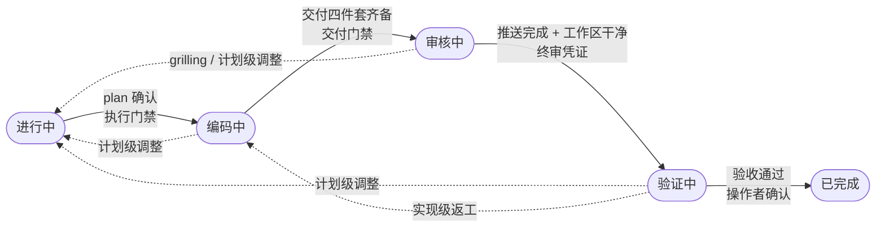
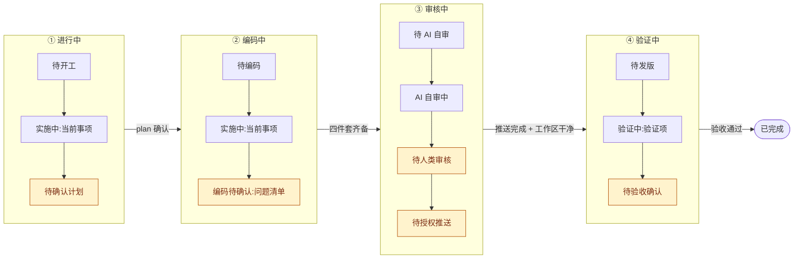

# feat-plan-research

> 需求开发流（`story/`：目录产物 / 执行步骤 / DoD / 全流程门禁）的单一真源。通用流程，不绑定具体业务。

## When（何时触发）

- `#feat` / `#需求` 任务**一开始**（开工第一步，先于产出任何交付物）。
- 简单单点直改可简化流程，但仍建议过门禁自查。
- 通用开工自检门禁对所有任务类型生效（见 [WORKFLOW §2.1](../../../WORKFLOW.md)）；本 skill 是需求开发的具体承载。

## Why（通用）

浅调研 / 预设方案 / 范围假设 → 多轮纠正与返工。开工先全景调研 + 自检，把返工消灭在动笔前。**调研深度不够是多轮纠正的总根源，预设方案是次因。**

## 规格判定（复杂度画像；大需求两增强门禁）

- **判定**（立项澄清阶段、README 建立时）：AI 按五维**复杂度画像**初判两档——`大需求` / `常规需求`：① 涉及面（跨仓 / 跨端 / 涉及层数）；② 逻辑深度（业务规则复杂度、链路长度、状态多寡）；③ 风险面（兼容硬约束、新旧并存、客户直集成）；④ 需求成熟度（待澄清 / 悬置决策多寡）；⑤ 验证面（场景矩阵、发版链长度）。**维度是判断输入、非硬触发**——仓数只是维度①的典型信号（跨多仓 trivial 可判常规，单仓深状态机可判大需求）。判定结果 + 主要依据写 README 一行（如「规格判定：大需求（命中：逻辑深度 + 风险面）」或「规格判定：常规需求」）；**操作者明示可指定 / 改判**（plan 确认时改判零成本——判定是分流不是门禁）。
- **判为大需求 → 触发两道增强门禁**（常规需求不触发、按常规流程即可）：
  1. **契约快照**（大需求 且 涉及跨端/跨仓接口/事件契约）：design.md 加「契约快照」节——粒度**三要素：字段 + 传参方式 + 值域枚举**，缺一不算冻结（反例模式：字段名对齐了但传参方式/值域没确认 → 返工、值传错），另含细节点确认清单；快照随 plan 过执行门禁一并确认（确认 plan 即确认快照）。**契约变更 = demand.md「变更记录」追加 + 强制附影响面评估行（几仓几文件），无评估不算合法变更**。产出前必读 [references/contract-snapshot-template.md](./references/contract-snapshot-template.md)。
  2. **增强项白名单**（大需求）：plan 前置节「功能基线与增强项白名单」——功能基线声明（1:1 对齐旧版（默认）/ 允许增强）+ 增强候选清单，随 plan 一并确认（不单独多一轮）。**编码期白名单外的功能想法 = 不实现**，记「编码待确认」攒批（与 AGENTS「执行专注主线，不顺手」同源）；review.md 自检含固定项**「计划外改动对照」**（见交付门禁 review.md 条）。产出前必读 [references/enhancement-whitelist-template.md](./references/enhancement-whitelist-template.md)。
- **条件模板（不绑定规格档位，命中即用）——设计对照与组件选型**（UI 涉及 且 有设计稿/原型/demo 输入；无设计输入的 UI 需求不适用）：plan.md 加「设计对照」节——组件映射表（设计区域 / demo 实现方式 / 目标仓组件 / 原生或缺口 / 备注五列）+ **缺口处置三选一经操作者确认**（现有组件近似替代 / 原生一次性实现 / 补组件库另立任务主任务只接线——缺口 ≠ 顺手造组件，防 scope 蔓延）+ 冲突优先级（设计标注 > demo 结构 > 库默认，冲突逐条登记不静默）+ 对照口径两级（demo 结构级 / 设计稿像素级）；映射表随 plan 一并过执行门禁，不单独多一轮。产出前必读 [references/design-mapping-template.md](./references/design-mapping-template.md)。
- **效果跟踪**：不设试行条款、不绑定业务任务做效果跟踪；迭代回顾需要时建任务评估（无效用即日落）。

## Lifecycle（状态机单一真源：五态全链）

- **状态集**：`{进行中, 编码中, 审核中, 验证中, 已完成}`（frontmatter `states:` 即 `workspace-check.py` 的机器校验登记处）。不设 `阻塞`（等待一律 CURRENT `blocker` 字段承载）与 `已取消`（放弃的任务走 `已完成`、原因记 CURRENT 历史）。

**状态转移主干**（实线 = 主线门禁、虚线 = 回边；不用 stateDiagram——其自动布局在多回边时交叉不可读）：



**各态内 next 站点序列**（真源 = 下方受控菜单，图仅为可视化；琥珀 = 操作者侧卡点——交接提醒/跳步防线绑定点，其余 AI 侧自动推进）：



- **各态语义与门禁**：
  - `进行中`：需求获取 / 分析 / 全景调研 / 代码真相确认 / 制定开发计划。出口门禁 = **执行门禁**（plan 经操作者确认）；**确认即转 `编码中`**——由收到确认的会话翻状态 + 收场（不编码，见下方会话边界）。
  - `编码中`：**新会话**（或过判据的隔离执行单元——plan 经确认即「决策已做完」，编码段是典型自主段，判据与协议见 [WORKFLOW §2.6](../../../WORKFLOW.md) 会话边界）进入先过下方「进入门禁三条」，读 demand.md + plan 确认（demand.md = 原始需求快照，实现语义与其冲突即疑惑）、有疑惑反问（判据见下）、无疑惑建 development worktree 按计划开发；完成 `review.md`（含「无法决策点」分区）→ 交付四件套齐备（见交付门禁）转 `审核中`。小任务不豁免会话边界。
  - **`编码中` 进入门禁（新会话进入 `编码中` 时逐条过，返工重入同适用）**：
    1. **计划二次分析（强制）**：先对 plan 可行性做二次分析、检查计划内部矛盾点——无误 → 按计划执行；有误 → 停止并提醒操作者；**操作者明示「按计划执行」也不跳过这轮分析**。
    2. **worktree + code-workspace**：创建 development worktree 时**同步创建** VSCode `.code-workspace`（多根工作区文件，含本任务相关仓 worktree 路径；生成方式见下方「交付门禁」），供操作者在 VSCode 里 review。
    3. **分支与版本规范**：先跑 `.tools/repo-family.py --repo <仓>` 判定基准分支与版本职责（低置信/有旗标 → 咨询操作者，不假设；工具信号正则未按仓群配置时，退回按 [AGENTS.md](../../../AGENTS.md)「代码视图隔离 · 基准分支判定」人工判定）；开发分支落后于主分支先合并好再建、fetch 后确认 `origin/<开发分支>` 在远端存在；worktree 细则（feature 分支两场景 / 路径 / 着陆卡 / 清理）= [references/worktree-protocol.md](./references/worktree-protocol.md)。
  - `审核中`：入态分支见下方「审核中子协议」。
  - `验证中`：发布后人工验证 + 修补，出路见下方「验证中出路三分法」；**验证期发现的问题一律登记 `verify-issues.md`**（根因归类 + 出路 + 修复状态，定位见 Outputs）——不追加进 review.md（review.md 是编码交付自检，交付后冻结）。**验证期首个会话先做 worktree 复核**：各涉及仓无未提交改动、开发分支与远端同头；异常登记 `verify-issues.md` 并停在复核点，不带病验证。
  - `已完成`：验收通过即完成，发版与否不影响。**硬终态，feat 不设 reopen**——验收后线上问题开新任务（`#case` 排查或 `#feat` 修复，新任务 README 引用旧任务）。`→ 已完成` 门禁 = 操作者验收确认（完成判定权，WORKFLOW §2.6 完成前闸门）+ 验证状态诚实记录（未验证就明说）+ §7 收尾门禁。
- **next/blocker 约定（next 受控菜单）**：next 只能取本态菜单内固定值——子状态 token 化、停留点显式化（带参数取值用 `:` 后缀跟摘要，**参数非空——裸冒号视为 next 未明确**）；越界取值按「next 未明确」自检纠正（token 级机检已落地：workspace-check NEXT_MENU，与本节菜单同步维护）：
  - `进行中` ∈ {`待开工`, `实施中:<当前事项>`（调研/写 plan）, `待确认计划`}；blocker 可非无（等素材/反问/等依赖）。
  - `编码中` ∈ {`待编码`（新会话已进未开码）, `实施中:<当前事项>`, `编码待确认:<问题清单>`}；blocker 可非无。
  - `审核中` ∈ {`待 AI 自审`, `AI 自审中`, `待人类审核`（含 grilling——无法决策点非空时人类审核首步）, `待授权推送`}；blocker 必无（等操作者是审核节奏本身，不是卡住）。
  - `验证中` ∈ {`待发版`, `验证中:<验证项>`, `待验收确认`}；blocker 可非无（**等发版 / 等验证环境 = 等外部真卡住**）。
  - `已完成` next/blocker 必无。
- **疑惑判据（一句话）**：「答案会不会改变 plan.md / design.md 里的决策」——不会（澄清性反问）→ 留 `编码中`，`blocker`/`next` 承载；会（计划级变更）→ 回 `进行中`。开始时与中途同一判据。
- **编码攒批确认（澄清性困惑不逐个打断）**：编码中遇到的澄清性困惑（疑惑判据判「不会改决策」的）**不即时停问操作者**——记入待确认清单继续开发，**一轮开发完成后、交付前统一批量确认**（next: `编码待确认:<问题清单>`，交接提醒逐条列出、操作者一次答完）；仅计划级阻塞（会改决策）立即停、回 `进行中`。防逐问打断操作者，也防带未决困惑硬交付。
- **会话边界**：任何状态翻转后，原会话只做「收场四件」（CURRENT 留痕 + 增量沉淀询问 + 必要时 workspace-check + 主动提议主题化提交——「一次翻转一落盘」，见 [WORKFLOW §2.6](../../../WORKFLOW.md)），新状态事项一律**新会话**（或过 WORKFLOW §2.6 自主段判据的隔离执行单元——两载体见该节）开启（`@` 任务 CURRENT.md 进入）；唯一例外 `已完成`（收尾动作本就在完成会话内走完）。铁律真源 = [WORKFLOW §2.6](../../../WORKFLOW.md)。
- **交接提醒（轮到操作者必显式提醒）**：AI 认为当前状态/子步骤 AI 侧工作已齐、**下一步动作在操作者侧**时（判据 = `next` ∈ 操作者侧菜单取值：`待确认计划` / `编码待确认:<…>` / `待人类审核` / `待授权推送` / `待验收确认`——菜单见上方「next/blocker 约定」），收尾输出（AI 结束回合等待操作者时的最终消息）**必须显式提醒**：「当前 `status: X`，轮到你：<具体动作>；完成后：<AI 下一步（翻态方式 / 新会话进入点）>」——与 `next` 同源，next 写什么就提醒什么。防「AI 侧完成 ≠ 阶段完成」误读（例见执行门禁「plan 产出会话必带交接提醒」）。
- **跳步防线（新会话推进指令先核状态）**：新会话收到「继续 / 编码 / 执行计划」类**推进**指令，第一步核对 CURRENT `status` + `next`：下一动作在操作者侧 → **不执行、停留**，输出同上交接提醒；操作者明示完成该动作（「确认计划 / 按计划执行 / 授权推送 / 验收通过」）→ 按对应「确认即转态」处理（翻态 + 收场四件，本会话不越阶执行）。明示认可即确认（见执行门禁「已批方案」）；泛「继续」「去做吧」**不算确认**，只触发提醒。状态内的非推进指令（如验证中发来验证结果、要求补充调研）不适用本防线，按所属状态正常处理。
- **架构能力反思（feat 触发点前移）**：转入 `验证中` 时主记录、转入 `已完成` 时补验证期信号——规则与各标签触发点单一真源 = [ARCHITECTURE.md](../../../ARCHITECTURE.md) §5 触发点表（`审核中 → 验证中` 转入非阻断：转态收场时提醒执行、未走由验证中首个会话补走）。

### 审核中子协议

- **入态分支（机械化，看 review.md 固定分区 `## 无法决策点`）**：
  - **非空** → 提醒操作者走 grilling 逐点决策 → 回 `进行中` 调计划（复走执行门禁）再进 `编码中`；
  - **空（显式写「无」，禁止省略节）** → **AI 自审修复轮（交付会话直接派隔离执行单元接续；原「新会话、操作者触发」已废止）**：
    - 执行方式：交付会话（四件套齐备转 `审核中`、收场前）直接派**隔离执行单元**执行——[WORKFLOW §2.6](../../../WORKFLOW.md) 第二载体，符合自主段判据（决策已做完 / 产物落真源 / 遇决策点即停）；prompt 自包含锚清单指针（plan 相关节 + review.md + worktree 路径，等价 `@` 进入不复制正文），主会话只传话不执行、一轮一报。
    - **review 对象 = 编码产出的代码变更**——development worktree 内各仓改动（`git diff`），按 `review.md` 改动清单与模块审查指引逐项自审，**不是审本工作区任务文档**。
    - **项目校验实跑硬门禁**：自审完成判据必须包含目标仓校验（lint/类型/测试，按仓既有配置）**本轮实际执行且通过**——worktree 缺依赖先装（包管理器 install 属允许操作，非 git 写）；个别工具环境性崩溃 → 显式登记未过项 + 根因，**经操作者确认放行**才算；未跑校验或仅以「CI 兜底」代替 = 自审未完成，不得翻 `待人类审核`。
    - 小修留态内 → 操作者终审打磨（代码级调整 AI 直接修；计划级调整回 `进行中`；自审轮与终审的**轮次明细（反馈条目 + 修复落点）记 `process-log.md`**）。
  - **转 `验证中`（判据机械化）**：授权合并推送完成（授权制，推送请求先过下方「推送前注释清扫门禁」；`git push origin HEAD:<开发分支>` 显式 refspec、默认 ff-only、禁裸 push，执行后恢复默认限制——worktree 默认直接检出开发分支，提交即进合并线）+ worktree 干净（无未提交改动）= **终审通过凭证，满足即转、不等显式「终审通过」宣告**（操作者授权推送即终审放行；推送后发现代码级问题走 `验证中 → 编码中` 回边）。推送明细（授权 / commit / 分支映射）物化 `process-log.md` git 操作记录表，CURRENT 只留一行 digest。
  - 自审轮中发现新决策点 → 升级同 grilling 路径（回 `进行中`）。
- **复杂交付全景图（审核辅助，条件触发）**：架构型任务（多场景壳 / 多层接线 / 多源数据流 / 新旧开关类）进入人类审核、md 产物入口难读时，按 [references/task-panorama.md](./references/task-panorama.md) 生成任务目录 `panorama.html`——照 worktree/git 实测、不照任务 md 抄（md 与代码冲突以代码为准并回报操作者），单文件自包含、只报路径不自动开浏览器；简单任务不造（默认会话内 Mermaid/表格内联）。
- **推送前注释清扫门禁**：翻 `待授权推送` 前对**待推变更全集**（未提交改动 + 领先 `origin/<开发分支>` 的提交；返工环每次推送同过）做一遍**决策引用注释清扫**——注释引用任务过程锚点/编号（操作场景号、验证问题号、决策号、子任务号、`design §N` 及 `operations.md`/`verify-issues.md`/`review.md` 等任务文档名）= 只在任务工作区语境可解，代码长期维护者无上下文：
  - **有长期价值的约束改写为自包含注释**（保留约束、去锚点，如「…见验证问题 V-37，不可裁剪」→「…不可裁剪」），**纯 review 辅助说明直接删**；项目注释规范保留形态、只清编码（如源仓要求的文件首行注释），外部持久单号（工单/需求单号）允许保留。开发/评审期不禁止此类注释（辅助 review 是正当用途），仅推送前必清。
  - 扫查为召回手段、逐处判断：待推 diff（`git diff HEAD` + `git diff origin/<开发分支>...HEAD`）的新增注释行 grep `S[0-9]+\b|V-[0-9]+|N-[0-9]+|T[0-9]+|design §|design\.md|plan\.md|operations\.md|verify-issues|review\.md`。
  - 清扫结果（调整处数 + 改写/删除去向）写进推送请求并记 `process-log.md`，注释调整与代码同批 commit——**授权推送的即最终态**。

### 验证中出路三分法

**问题先登记后出路**：验证中发现的每个问题，先落 `verify-issues.md` 一行（问题 / 根因 / 归类 / 出路 / 修复状态，模板见 Outputs），再按下列出路执行；**归类区分「开发盲点（开发考虑不到导致）」与「其他」**（需求澄清 / 环境问题 / 既有缺陷 / 产品反馈）——收尾复盘按归类统计开发盲点，反哺经验沉淀。

1. **补丁级**（单点小修、无契约变化）→ 留态内直接修 + 操作者确认；
2. **实现级返工**（plan/design 没错、代码要重改或改动面大）→ 回 `编码中`——plan 未变不需重新确认，复走「编码中 → 审核中 → 合并推送」环回 `验证中`；
3. **计划级** → 回 `进行中` 调计划、复走执行门禁（判据与疑惑判据同源：改不改 plan/design 决策）。**单日闭环小规模补充轮豁免**：联调前变动等当日闭环的小规模补充轮可不显式回 `进行中`——补充 plan 件经操作者确认 + review.md 追加交付自检 + verify-issues 登记问题侧即视为门禁等价；跨日或大范围计划变动不适用、仍须回 `进行中`。

### 返工防漂移（防返工循环的上下文膨胀）

1. **会话边界即解药**：每次状态翻转强制换会话，返工循环每段（发现 → 编码 → 审核 → 回验证）冷启动，上下文靠产物真源（plan / review / CURRENT）重建、对话历史不跨段累积——返工多次也不叠加上下文。
2. **产物增量记录**：plan.md 不因返工改写全文（沿用 Steps「决策变更同步」的「标记旧结论失效 + 增量记录」）；编码期自审/返工记录增补进 review.md「返工记录」节，**验证期问题与返工增补进 verify-issues.md**（登记处分离——review.md 冻结于交付 / verify-issues.md 活到验收；**物化过程明细（授权 / git 操作记录 / review 轮次 / 发布状态）归 process-log.md**，CURRENT 只留 digest）；CURRENT 历史三条上限（既有硬规则）。
3. **返工会话重读锚清单**：重入 `编码中`/`审核中` 时必读 demand.md（原始需求）+ plan 相关子任务节 + review.md（无法决策点 / 返工记录）+ CURRENT 当前进度；重入 `验证中` 时加读 verify-issues.md（未决问题 / 修复状态）——从真源重建理解，不靠上一轮记忆。
4. **打转软警示**：`验证中 → 编码中` 实现级返工累计 ≥3 次 → AI 在 CURRENT 留痕并提醒操作者「反复实现级返工通常是计划级问题的信号，是否回 `进行中` 重新评估」——提醒不阻断，判定权在操作者。

## 任务流（story 执行步骤 + DoD）

**执行步骤（全生命周期）**：

1. **澄清** → `README.md`（目标/范围/验收口径，AI 理解转述）+ **立项即建 `demand.md`**（原始需求第一手承接，先于任何转述与调研、全程强制）：按启动来源落原始快照——工单启动（标题/正文/需求类评论**逐字快照** + 单号链接 + 拉取时间）/ 调研启动（调研任务指针 + 报告结论要点 + 操作者启动决策原话）/ 会话启动（操作者指示原话）/ 设计稿·原型启动（链接 + 操作者意图原话；已还原 demo 的附 demo 指针）。**逐字保留、不改写不概括**（模板见 Outputs）；README 的目标/范围/验收口径是转述——两者分工，转述丢掉的细节靠 demand.md 兜底。
2. **调研（全景，别挤牙膏）** → 走本 skill「Steps + 开工自检门禁」，把约束写进 `design.md`。
3. **设计** → 产出技术方案，标注：影响的现有模块、兼容性、回滚方案。
4. **拆解** → `plan.md` 列出可独立验证的子任务与优先级；每个子任务至少包含仓库/模块、文件或入口、具体改动、依赖、数据/接口契约和**验证命令 + 期望输出**（禁占位符——「适当处理异常」「参考任务 N」这类表述出现 = plan 未过门禁；可局部化的检查给单文件命令，不可局部化的全量检查不强求本机执行、标注 CI 兜底）。跨仓库需求另输出落地变更图（仓库矩阵 + 前后端时序 + 部署顺序）。
5. **实现** → 编码前过「执行门禁」（见下节：plan 经操作者确认，**确认即转 `编码中`**、确认会话只收场）；开发走独立 development worktree（分支规范见 Lifecycle「`编码中` 进入门禁」第 3 条，细则真源 = [AGENTS.md](../../../AGENTS.md)「代码视图隔离」）；进入编码后，若目标仓 `AGENTS.md` 缺失/过时**且本次改动范围广** → 提议以 `agents-md-refiner` skill 完善/初始化（经操作者同意才动；属主线依赖不算顺手打包；调研阶段只读不完善，见 Steps 第 1 条）；git 边界（只编辑不提交、review 后可询授权合并推送）见 [AGENTS.md](../../../AGENTS.md) 安全红线；同步更新 `CURRENT.md`（含 `status` 迁移）。
6. **自检** → 对照验收口径逐条核对；检查边界、并发、异常、安全。
7. **交付准备**（转 `审核中` 前，非收尾——收尾专指 `已完成`）→ 过「交付门禁」四件套；可复用经验沉淀到 `exps/`（WORKFLOW §2.4/§4）。

**review 方式**：对象是 worktree 内的实际改动（**AI 自审轮与操作者终审同此对象**——AI 自审主动 `git diff` 逐项过，操作者直接 `git diff` 或在 worktree 查看），不导出游离 `.diff` 文件作 review 产物，也不把「自审」做成审本工作区任务文档；编码完成后通知操作者基于 worktree review。

**DoD（完成定义）**：

- [ ] 验收口径全部达成并有验证依据；
- [ ] `design.md` 中标注的影响面均已处理或确认无碍；
- [ ] 「交付四件套」齐备：reviewable 工作区 + `review.md` 自检（含 `## 无法决策点` 固定分区，空时显式写「无」；**项目校验实跑通过**——口径见交付门禁 review.md 条）+ `process-log.md` 骨架（见 Outputs）+ `status: 审核中`；
- [ ] `CURRENT.md` 状态与进度完整，无未说明的阻塞；`status` 已即时维护（五态见 Lifecycle）；
- [ ] 已沉淀经验（如有）到 `exps/`。

## Steps（开工全景调研）

1. **仓库概况优先（调研只读）**：调研第一个动作 = 读每个涉及仓库根目录的 `AGENTS.md`（若存在），获取该仓开发约定 / 规范 / 架构说明（全局红线既有要求，见 AGENTS.md「项目代码规范」），判断仓库概况、规范遵循点与影响范围；同时跑 `.tools/repo-family.py --repo <涉及仓>` 判定各仓基准分支与版本职责（低置信/多产品线/宿主型旗标 → 列入待确认问操作者；工具信号正则未配置时退回 [AGENTS.md](../../../AGENTS.md)「代码视图隔离 · 基准分支判定」），写入 `design.md` 仓库清单；**调研阶段只读，不在本阶段完善 / 初始化它**——`AGENTS.md` 缺失或过时的完善/初始化由编码阶段承接（见任务流第 5 步「实现」）。
2. **识别涉及面**：本任务涉及哪些层？逐一列出——前端模块、后端服务、数据 / 配置、是否跨端、兼容性、边界交互（搜索 / 筛选 / 分页 / 权限等）。**遗漏的层 = 后续返工源**；跨端需求前后端**同步**调研，不等用户提醒。
3. **逐层读代码定位现状**：每个涉及的层，**读代码**搞清现状（不只 grep 关键词）；区分「已核实事实」与「假设」。
   - 先建立源码仓库、包依赖、monorepo 子包、第三方 SDK 清单；每项确认源码真源、实际调用方和实现方。缺源码先定位/clone，无法获取时阻塞文件级计划。
   - 跨服务功能沿「组件 → SDK/宿主 → API URL → Controller → 聚合 Service → RPC/Feign → 最终 Service」追踪；一次 grep 无结果只能记为限定范围内未观察到，必须扩大路径/关键词后才收敛。
4. **画数据流 / 影响链**：数据 / 请求从哪来 → 怎么存 / 处理 → 怎么展示 → 哪些页面 / 服务复用 → 边界交互在哪做，落到 `design.md`；复杂跨仓需求额外输出落地变更图，标明每个仓库的具体文件/入口和变更责任。
   - 共享组件必须拆开确认「UI/事件、运行时 controller、域名/请求器/鉴权、错误码/倒计时」；优先检查现有 controller 注入模式，避免每个宿主重复实现共通流程。
   - 涉及第三方能力契约（验证码 / 支付 / 推送 / 登录 SDK 等）必须同时核对：类型与版本、调用必填参数、SDK 加载与域名依赖、错误码 / 频率限制、缓存 key 及收发/校验格式一致性。
5. **范围边界主动确认**：每条候选边界（是否纳入某模块 / 某端 / 某交互 / 兼容 / 文案）问清操作者，**不假设**。
6. **方案基于事实**：不确定的标「待核实」，**不预设**方案（预设 = 埋返工雷）。**链路复杂时的 MVP 骨架验证**：静态读码不足以确认数据流可拼性时（跨仓拼接点 / 字段透传 / SDK 加载链 / 事件时序），先搭最小 MVP 骨架跑通一条端到端数据流，确认设计拼得上再铺开全量详细设计与改动——MVP 是验证设计的骨架，功能仍一起交付、不分期（防「详细设计做完才发现拼不上」）。
7. **决策变更同步**：需求验收、范围、仓库归属或技术方案发生修订时，**需求侧变更先落 `demand.md`「变更记录」区**（追加一行：来源/日期/内容快照/影响判断——快照区永不回写，远端改动自留底），再标记旧结论失效，扫描并同步任务目录全部产物；旧方案未清理前不得继续按旧计划编码。

## Gates（开工自检门禁）

**任务开工、产出任何交付物（README / design / plan）前，以下全「是」才继续**；任一「否」→ 补调研 / 问操作者，不动笔：

- [ ] `demand.md` 是否已建且原始快照完整（启动来源 + 获取时间 + 逐字原文；工单启动时需求类评论已一并快照）？
- [ ] 涉及仓库的**基准分支与版本职责**是否已判定（低置信 / 多产品线 / 宿主型是否已问操作者）？
- [ ] 涉及的**所有层**（前端各模块 / 后端各服务 / 数据 / 配置 / 兼容 / 边界交互）是否都已读代码定位现状？
- [ ] 是否画出**数据流 / 影响链**（来源 → 存储 → 处理 → 展示 → 复用 → 边界交互）？
- [ ] **范围边界**（每条「是否纳入」）是否已和操作者确认，而非假设？
- [ ] 方案是否有「没读代码就下的假设」（有的标「待核实」，不下结论）？
- [ ] 是否还有「等操作者提醒才去看」的层面？
- [ ] 涉及的每个源码仓库、包依赖、monorepo 子包和第三方 SDK 是否都已定位真源并读过调用方与实现方？
- [ ] 是否沿完整调用链确认真实入口、聚合层透传、最终校验/写入边界，而不是只依据类名、包名或一次搜索结果？
- [ ] 共享组件是否已区分 UI/事件与运行时能力，是否检查了 controller 注入、向后兼容和所有主要调用方？
- [ ] 涉及第三方能力契约（验证码 / 支付 / 推送等）是否核对了类型版本、必填参数、加载方式、域名依赖、错误码、频率限制及缓存 key？
- [ ] 若需求或方案中途发生修订，是否已扫描 README/design/plan/changes/CURRENT/INDEX，确认没有残留旧结论？
- [ ] 调研边界是否被**任务类型标签 / 故事点 / 「前端任务」「小需求」**等假设自我设限？可行性一旦卡在「系统如何判定 X」，是否回 `src/` 代码（含后端）核实，而非止步当前（前端）仓库？

> 反例信号：交付物产出后立刻被纠「漏了 X / 不是 Y」，几乎都是上面某条没过。

## 复核点

- **写 plan 前**：开工已过门禁，写 `plan.md` 前再过一遍（有无新盲区、待核实项是否已闭环）。
  - 若任一涉及仓库/包未读、调用链未闭环、公共组件边界未确定或第三方契约未确认，只能输出调研阻塞清单，不得写文件/方法级实现计划。
  - **对照 demand.md**：plan 每条任务与验收口径须可回溯到需求原文；原文有而 plan 无的原始需求点，纳入或列入待确认问操作者——**不静默丢弃**。

## 执行门禁（编码前：plan 须操作者确认；确认即转 `编码中`）

**任何新任务（含子任务 / 深度扩展 / 同 worktree 内的后续增强）→ 先出开发计划 → 操作者确认 → 才编码。** 不自动实现。

- **确认即转 `编码中`**：收到操作者确认的会话只翻 `status: 编码中` + 收场四件（**本会话不编码**，编码在**新会话**开始、按 Lifecycle 锚清单恢复上下文）。
- **plan 产出会话必带交接提醒**：plan 输出完成的会话，收尾必须显式提醒「计划输出完成 ≠ 已确认——请确认 plan（或提出调整），确认后我才转 `编码中`、编码新会话开始」（交接提醒与跳步防线总则见 Lifecycle；防操作者误读「已输出」为「已确认」、新开会话直接要求编码跳过本门禁——此时新会话按跳步防线先核状态再提醒，不直接开工）。
- **已批方案**（操作者明确「按计划直接开发」）→ 同上转态，新会话直接编码。
- **新设计决策**（触发点 / 同步异步 / 参数语义 / 范围边界 / 技术选型 / 取舍）→ **先出 plan，操作者确认后再编码**；哪怕任务进行中冒出的子需求也适用，不要因「在已批任务内」就自动实现。

## 交付门禁（编码完成 ≠ 交付，非收尾）

> **术语**：这是**交付**（转 `审核中`，给操作者 review），**不是收尾**（收尾专指转 `已完成`，见 [WORKFLOW §2.6](../../../WORKFLOW.md)「收尾 vs 交付」）。别把交付当任务终结。

**转 `审核中` 前，以下「交付四件套」齐备才算交付**；任一缺失 = 未交付，不算「编码完成」：

- [ ] **reviewable 工作区**：任务目录内 `dev-<task>.code-workspace`（或用任务目录名命名），多根含 docs + 各 worktree。
  - **生成方式**：用 `.tools/sync-worktree-workspace.py --task <id> --story <任务目录名>`（模板真源 `workspace-code-setting/`，顺带生成着陆卡 AGENTS.md）；否则手写 JSON——必须配 `git.repositoryScanMaxDepth: 6`（VS Code 发现深层 worktree 所需）并逐 folder 核对相对路径，不凭记忆写路径。
  - **folder.name 规范与字符红线、settings 骨架**：创建/改名前必读 [references/code-workspace-naming.md](./references/code-workspace-naming.md)。**改完 `.code-workspace` 必须 `Developer: Reload Window` 才生效**。
- [ ] **`review.md` 自检**：**验收证据表**——每条验收口径标注 AUTO（附验证命令 + 实际输出摘录，须本轮新鲜运行，禁止引用历史输出或「应该能过」式推断）或 MANUAL（附步骤化测试清单：前置条件 / 操作步骤 / 期望现象，交操作者执行），达成状态记达成 / 按已确认决策落地 / 待办。
  - **验收口径逐条回溯 `demand.md` 需求原文**（每条原始需求点有落点或显式排除说明——不静默丢需求）；变更涉及的既有功能标注回归风险并列入核对。
  - 大需求另含固定项**「计划外改动对照」**（对照 plan 子任务清单逐项过 diff，plan 外功能性改动逐条列出：补确认或撤码——防「顺手加」漏到验收期）。
  - **项目校验实跑记录（硬门禁）**：lint/类型/测试按仓配置本轮新鲜执行且通过；缺依赖先装；工具环境性崩溃类未过项须显式登记根因并经操作者放行——「CI 兜底」代替 = 交付自检未完成，与 AI 自审轮同口径。
  - 另含健壮性/边界自检、待 review 决策点、遗漏项、改动文件清单（分层列改动文件及说明）、关键设计决策（决策项 + 依据）、按模块审查指引；**固定二级标题 `## 无法决策点`**（留给操作者的决策清单，空时显式写「无」，禁止省略节——`审核中` 入态分支按此机械化分流）。
  - 定位：`.code-workspace` 管 diff 可视化、`review.md` 管设计意图说明，两者互补。**review.md 是编码交付自检，转 `审核中` 后冻结**——验证期发现的问题不追加进 review.md，一律登记 `verify-issues.md`（见 Outputs）。
- [ ] **status 严格枚举**：`审核中`（纯枚举值，**禁带括号说明**，见 [WORKFLOW §2.6](../../../WORKFLOW.md)）。
- [ ] **`process-log.md` 骨架**：物化过程明细标准承载（操作者授权记录、git 操作记录表、部署顺序/版本链、review 轮次明细——结构与模板见 Outputs）；本阶段起过程明细**只落此文件**，`CURRENT.md` 回归 digest + 指针（正文非空行 >60 触发 workspace-check 告警）。

**交付节点同时做（别拖到收尾）**：① 沉淀询问（AI 主动，回顾编码阶段教训，§2.4）；② `workspace-check --task <当前任务>`（兜底，转审核中前跑一次）。

> 反例：「代码写完」不等于「交付」（漏工作区 / review.md / 用非标 status 都算未交付）；把「交付」当「收尾」（提前判定任务终结、跳过 `验证中`）也是同类错误。

## Outputs（目录产物）

```text
story/feat-YYYY-MM-DD-xxx/
├── README.md        # 背景、目标、验收标准、相关链接、产物索引（静态；H1 = 任务目录名）
├── CURRENT.md       # 活状态 digest：status/next/blocker + 进度 + 最近3条历史（WORKFLOW §2.6；过程明细归 process-log.md）
├── demand.md        # 原始需求承接（立项即建、全程强制）：来源 + 逐字快照 + 追加式变更记录（模板见下）
├── plan.md          # 开发计划：任务拆解、依赖、里程碑、风险（门禁全过后产出；编码中起为强制产物）
├── design.md        # 技术设计（可选，复杂需求必填）：方案、接口、数据、影响面、兼容、回滚
├── review.md        # 自检与回顾（交付前填写，即转审核中前；转审核中后冻结）：健壮性、遗漏点、无法决策点、可复用经验
├── process-log.md   # 过程日志（审核中起为强制产物）：操作者授权、git 操作记录、部署顺序/版本链、review 轮次明细
└── verify-issues.md # 验证期问题登记（验证中起为强制产物）：问题清单（根因归类/出路/修复状态）+ 固定分区「## 问题清单」
```

> **verify-issues.md 结构与模板**（与 review.md 分工：review 冻结于交付、verify-issues 活到验收）：进入 `验证中` 时创建骨架（`## 问题清单` 分区，无问题时显式写「无」，禁止省略节），发现问题逐条追加表格行；归列为「开发盲点」= 开发阶段考虑不到导致的问题（编码时未预见、验证才暴露）——收尾复盘按此列统计，反哺经验沉淀：

```markdown
## 问题清单

| # | 问题 | 根因 | 归类（开发盲点/需求澄清/环境问题/既有缺陷/产品反馈） | 出路（补丁级/实现级/计划级） | 修复状态 |
| --- | --- | --- | --- | --- | --- |
| 1 | 现象描述 | 一句话根因 | 开发盲点 | 补丁级 | 已修复（commit/验证） |
```

> **process-log.md 结构与模板**（三分登记：review.md 冻结于交付 / verify-issues.md 活到验收管验证期问题 / process-log.md 活到验收管物化过程明细）：转 `审核中` 时创建骨架，此后授权、推送、轮次、发布状态等明细**只落此文件**，CURRENT 留一行 digest + 指针：

```markdown
# 过程日志（物化过程明细；CURRENT 只留 digest）

## 操作者授权记录

- YYYY-MM-DD 授权内容与边界（凭证物化，替代口头记忆）

## git 操作记录

| 仓库 | 单号 | commit | 推送目标 | 说明 |
| --- | --- | --- | --- | --- |

## 部署顺序 / 版本链

（合并节奏约束、版本 bump、发版状态快照）

## review 轮次

（自审轮 / 终审打磨：反馈条目 + 修复落点，逐轮追加；验证期问题不入此节，走 verify-issues.md）
```

> **demand.md 结构与模板**（原始需求第一手承接，story 立项即建、全程强制；机器校验只查文件存在性，内容按本模板）：**逐字快照、不改写不概括**；README 的目标/范围/验收口径是 AI 理解转述，两者分工——转述丢掉的细节靠 demand.md 兜底。远端（工单/协作平台）需求后续改动**只追加「变更记录」、永不回写快照区**（联动 Steps「决策变更同步」）：

```markdown
# 原始需求（demand.md）

## 来源

- 启动来源：工单（单号/链接）/ 调研（research 任务路径）/ 会话指示 / 设计稿·原型（链接；已还原 demo 的附 demo 指针）
- 获取时间：YYYY-MM-DD（快照时点）+ 获取方式（工单工具拉单 / 调研报告摘录 / 会话原话 / 设计稿链接 + demo 指针）

## 需求原文（立项快照，永不回写）

（工单标题/正文/需求类评论逐字快照；或调研结论要点 + 操作者启动决策原话；或操作者会话指示原话；或设计稿/原型地址 + 操作者意图原话 + demo 指针）

## 变更记录（追加式；远端需求改动时登记）

| 日期 | 变更来源 | 变更内容（快照/摘录） | 影响判断（计划级/实现级/无影响） | 处置 |
| --- | --- | --- | --- | --- |
```

> 代码不放任务目录，统一写在 `src/` 对应仓库的 development worktree；在 `README.md` 标注涉及的仓库与分支。
> **跨前后端协同**时 `plan` 拆为 `plan-frontend.md` + `plan-backend.md`（各自自包含：背景/契约/任务/验证/风险）+ `plan.md`（总览：核心契约/依赖/部署顺序/里程碑）；前后端可并行推进，前端按契约先行（接口失败降级）、后端可后上。
