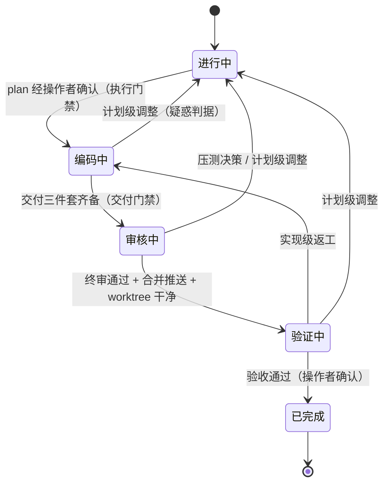

# feat-plan-research

> 需求开发流（`story/`：目录产物 / 执行步骤 / DoD / 全流程门禁）的单一真源。通用流程，不绑定具体业务。

## When（何时触发）

- `#feat` / `#需求` 任务**一开始**（开工第一步，先于产出任何交付物）。
- 简单单点直改可简化流程，但仍建议过门禁自查。
- 通用开工自检门禁对所有任务类型生效（见 [WORKFLOW §2.1](../../../WORKFLOW.md)）；本 skill 是需求开发的具体承载。

## Why（通用）

浅调研 / 预设方案 / 范围假设 → 多轮纠正与返工。开工先全景调研 + 自检，把返工消灭在动笔前。**调研深度不够是多轮纠正的总根源，预设方案是次因。**

## Lifecycle（状态机单一真源：五态全链）

- **状态集**：`{进行中, 编码中, 审核中, 验证中, 已完成}`（frontmatter `states:` 即 `workspace-check.py` 的机器校验登记处）。不设 `阻塞`（等待一律 CURRENT `blocker` 字段承载）与 `已取消`（放弃的任务走 `已完成`、原因记 CURRENT 历史）。



- **各态语义与门禁**：
  - `进行中`：需求获取 / 分析 / 全景调研 / 代码真相确认 / 制定开发计划。出口门禁 = **执行门禁**（plan 经操作者确认）；**确认即转 `编码中`**——由收到确认的会话翻状态 + 收场（不编码，见下方会话边界）。
  - `编码中`：**新会话**（或过判据的隔离执行单元——plan 经确认即「决策已做完」，编码段是典型自主段，判据与协议见 [WORKFLOW §2.6](../../../WORKFLOW.md) 会话边界）进入先过下方「进入门禁三条」，读 plan 确认、有疑惑反问（判据见下）、无疑惑建 development worktree 按计划开发；完成 `review.md`（含「无法决策点」分区）→ 交付三件套齐备（见交付门禁）转 `审核中`。小任务不豁免会话边界。
  - **`编码中` 进入门禁（新会话进入 `编码中` 时逐条过，返工重入同适用）**：
    1. **计划二次分析（强制）**：先对 plan 可行性做二次分析、检查计划内部矛盾点——无误 → 按计划执行；有误 → 停止并提醒操作者；**操作者明示「按计划执行」也不跳过这轮分析**。
    2. **worktree + code-workspace**：创建 development worktree 时**同步创建** VSCode `.code-workspace`（多根工作区文件，含本任务相关仓 worktree 路径；生成方式见下方「交付门禁」），供操作者在 VSCode 里 review。
    3. **分支与版本规范**：基准分支与版本职责按 [AGENTS.md](../../../AGENTS.md)「代码视图隔离 · 基准分支判定」判定（低置信 → 咨询操作者，不假设）；开发分支落后于主分支先合并好再建、fetch 后确认 `origin/<开发分支>` 在远端存在。
  - `审核中`：入态分支见下方「审核中子协议」。
  - `验证中`：发布后人工验证 + 修补，出路见下方「验证中出路三分法」。
  - `已完成`：验收通过即完成，发版与否不影响。**硬终态，feat 不设 reopen**——验收后线上问题开新任务（`#case` 排查或 `#feat` 修复，新任务 README 引用旧任务）。`→ 已完成` 门禁 = 操作者验收确认（完成判定权，WORKFLOW §2.6 完成前闸门）+ 验证状态诚实记录（未验证就明说）+ §7 收尾门禁。
- **next/blocker 约定**（workspace-check 按此校验）：`进行中`/`编码中` next 必填、blocker 可非无（等确认 / 反问 / 等联调）；`审核中` next 必填（写当前子步骤：待压测决策 / AI 自审轮待触发 / 待操作者终审）、blocker 必无（等操作者是审核节奏本身，不是卡住）；`验证中` next 必填（验证项）、blocker 可非无（**等发版 / 等验证环境 = 等外部真卡住**）；`已完成` next/blocker 必无。
- **疑惑判据（一句话）**：「答案会不会改变 plan.md / design.md 里的决策」——不会（澄清性反问）→ 留 `编码中`，`blocker`/`next` 承载；会（计划级变更）→ 回 `进行中`。开始时与中途同一判据。
- **会话边界**：任何状态翻转后，原会话只做「收场三件」（CURRENT 留痕 + 增量沉淀询问 + 必要时 workspace-check），新状态事项一律**新会话**开启（`@` 任务 CURRENT.md 进入）；唯一例外 `已完成`（收尾动作本就在完成会话内走完）。铁律真源 = [WORKFLOW §2.6](../../../WORKFLOW.md)。

### 审核中子协议

- **入态分支（机械化，看 review.md 固定分区 `## 无法决策点`）**：
  - **非空** → 提醒操作者逐点决策（可用追问式压测收敛）→ 回 `进行中` 调计划（复走执行门禁）再进 `编码中`；
  - **空（显式写「无」，禁止省略节）** → AI 自审修复轮（**新会话**、操作者触发；**review 对象 = 编码产出的代码变更**——development worktree 内各仓改动（`git diff`），按 `review.md` 改动清单与模块审查指引逐项自审，**不是审本工作区任务文档**）→ 小修留态内 → 操作者终审打磨（代码级调整 AI 直接修；计划级调整回 `进行中`）→ 终审通过 + 合并推送完成（授权制，`--ff-only`，执行后恢复默认限制；worktree 默认直接检出开发分支，改动提交即进合并线）+ worktree 干净（无未提交改动）+ CURRENT 留痕 → 转 `验证中`。
  - 自审轮中发现新决策点 → 升级同压测决策路径（回 `进行中`）。

### 验证中出路三分法

1. **补丁级**（单点小修、无契约变化）→ 留态内直接修 + 操作者确认；
2. **实现级返工**（plan/design 没错、代码要重改或改动面大）→ 回 `编码中`——plan 未变不需重新确认，复走「编码中 → 审核中 → 合并推送」环回 `验证中`；
3. **计划级** → 回 `进行中` 调计划、复走执行门禁（判据与疑惑判据同源：改不改 plan/design 决策）。

### 返工防漂移（防返工循环的上下文膨胀）

1. **会话边界即解药**：每次状态翻转强制换会话，返工循环每段（发现 → 编码 → 审核 → 回验证）冷启动，上下文靠产物真源（plan / review / CURRENT）重建、对话历史不跨段累积——返工多次也不叠加上下文。
2. **产物增量记录**：plan.md 不因返工改写全文（沿用 Steps「决策变更同步」的「标记旧结论失效 + 增量记录」）；自审/返工记录增补进 review.md「返工记录」节；CURRENT 历史三条上限（既有硬规则）。
3. **返工会话重读锚清单**：重入 `编码中`/`审核中` 时必读 plan 相关子任务节 + review.md（无法决策点 / 返工记录）+ CURRENT 当前进度——从真源重建理解，不靠上一轮记忆。
4. **打转软警示**：`验证中 → 编码中` 实现级返工累计 ≥3 次 → AI 在 CURRENT 留痕并提醒操作者「反复实现级返工通常是计划级问题的信号，是否回 `进行中` 重新评估」——提醒不阻断，判定权在操作者。

## 任务流（story 执行步骤 + DoD）

**执行步骤（全生命周期）**：

1. **澄清** → `README.md`（目标/范围/验收口径）。
2. **调研（全景，别挤牙膏）** → 走本 skill「Steps + 开工自检门禁」，把约束写进 `design.md`。
3. **设计** → 产出技术方案，标注：影响的现有模块、兼容性、回滚方案。
4. **拆解** → `plan.md` 列出可独立验证的子任务与优先级；每个子任务至少包含仓库/模块、文件或入口、具体改动、依赖、数据/接口契约和**验证命令 + 期望输出**（禁占位符——「适当处理异常」「参考任务 N」这类表述出现 = plan 未过门禁；可局部化的检查给单文件命令，不可局部化的全量检查不强求本机执行、标注 CI 兜底）。跨仓库需求另输出落地变更图（仓库矩阵 + 前后端时序 + 部署顺序）。
5. **实现** → 编码前过「执行门禁」（见下节：plan 经操作者确认，**确认即转 `编码中`**、确认会话只收场）；开发走独立 development worktree（分支规范见 Lifecycle「`编码中` 进入门禁」第 3 条，细则真源 = [AGENTS.md](../../../AGENTS.md)「代码视图隔离」）；进入编码后，若目标仓 `AGENTS.md` 缺失/过时**且本次改动范围广** → 提议完善/初始化它（用 agents-md-refiner skill，经操作者同意才动；属主线依赖不算顺手打包；调研阶段只读不完善，见 Steps 第 1 条）；git 边界（只编辑不提交、review 后可询授权合并推送）见 [AGENTS.md](../../../AGENTS.md) 安全红线；同步更新 `CURRENT.md`（含 `status` 迁移）。
6. **自检** → 对照验收口径逐条核对；检查边界、并发、异常、安全。
7. **交付准备**（转 `审核中` 前，非收尾——收尾专指 `已完成`）→ 过「交付门禁」三件套；可复用经验沉淀到 `exps/`（WORKFLOW §2.4/§4）。

**review 方式**：对象是 worktree 内的实际改动（**AI 自审轮与操作者终审同此对象**——AI 自审主动 `git diff` 逐项过，操作者直接 `git diff` 或在 worktree 查看），不导出游离 `.diff` 文件作 review 产物，也不把「自审」做成审本工作区文档；编码完成后通知操作者基于 worktree review。

**DoD（完成定义）**：

- [ ] 验收口径全部达成并有验证依据；
- [ ] `design.md` 中标注的影响面均已处理或确认无碍；
- [ ] 「交付三件套」齐备：reviewable 工作区 + `review.md` 自检（含 `## 无法决策点` 固定分区，空时显式写「无」）+ `status: 审核中`；
- [ ] `CURRENT.md` 状态与进度完整，无未说明的阻塞；`status` 已即时维护（五态见 Lifecycle）；
- [ ] 已沉淀经验（如有）到 `exps/`。

## Steps（开工全景调研）

1. **仓库概况优先（调研只读）**：调研第一个动作 = 读每个涉及仓库根目录的 `AGENTS.md`（若存在），获取该仓开发约定 / 规范 / 架构说明（全局红线既有要求，见 AGENTS.md「项目代码规范」），判断仓库概况、规范遵循点与影响范围；同时按 [AGENTS.md](../../../AGENTS.md)「代码视图隔离 · 基准分支判定」确认各仓基准分支与版本职责（低置信 → 列入待确认问操作者），写入 `design.md` 仓库清单；**调研阶段只读，不在本阶段完善 / 初始化它**——`AGENTS.md` 缺失或过时的完善/初始化由编码阶段承接（见任务流第 5 步「实现」）。
2. **识别涉及面**：本任务涉及哪些层？逐一列出——前端模块、后端服务、数据 / 配置、是否跨端、兼容性、边界交互（搜索 / 筛选 / 分页 / 权限等）。**遗漏的层 = 后续返工源**；跨端需求前后端**同步**调研，不等用户提醒。
3. **逐层读代码定位现状**：每个涉及的层，**读代码**搞清现状（不只 grep 关键词）；区分「已核实事实」与「假设」。
   - 先建立源码仓库、包依赖、monorepo 子包、第三方 SDK 清单；每项确认源码真源、实际调用方和实现方。缺源码先定位/clone，无法获取时阻塞文件级计划。
   - 跨服务功能沿「组件 → SDK/宿主 → API URL → Controller → 聚合 Service → RPC/Feign → 最终 Service」追踪；一次 grep 无结果只能记为限定范围内未观察到，必须扩大路径/关键词后才收敛。
4. **画数据流 / 影响链**：数据 / 请求从哪来 → 怎么存 / 处理 → 怎么展示 → 哪些页面 / 服务复用 → 边界交互在哪做，落到 `design.md`；复杂跨仓需求额外输出落地变更图，标明每个仓库的具体文件/入口和变更责任。
   - 共享组件必须拆开确认「UI/事件、运行时 controller、域名/请求器/鉴权、错误码/倒计时」；优先检查现有 controller 注入模式，避免每个宿主重复实现共通流程。
   - 涉及第三方能力契约（验证码 / 支付 / 推送 / 登录 SDK 等）必须同时核对：类型与版本、调用必填参数、SDK 加载与域名依赖、错误码 / 频率限制、缓存 key 及收发/校验格式一致性。
5. **范围边界主动确认**：每条候选边界（是否纳入某模块 / 某端 / 某交互 / 兼容 / 文案）问清操作者，**不假设**。
6. **方案基于事实**：不确定的标「待核实」，**不预设**方案（预设 = 埋返工雷）。
7. **决策变更同步**：需求验收、范围、仓库归属或技术方案发生修订时，先标记旧结论失效，再扫描并同步任务目录全部产物；旧方案未清理前不得继续按旧计划编码。

## Gates（开工自检门禁）

**任务开工、产出任何交付物（README / design / plan）前，以下全「是」才继续**；任一「否」→ 补调研 / 问操作者，不动笔：

- [ ] 涉及仓库的**基准分支与版本职责**是否已判定（低置信 / 多产品线 / 宿主型是否已问操作者）？
- [ ] 涉及的**所有层**（前端各模块 / 后端各服务 / 数据 / 配置 / 兼容 / 边界交互）是否都已读代码定位现状？
- [ ] 是否画出**数据流 / 影响链**（来源 → 存储 → 处理 → 展示 → 复用 → 边界交互）？
- [ ] **范围边界**（每条「是否纳入」）是否已和操作者确认，而非假设？
- [ ] 方案是否有「没读代码就下的假设」（有的标「待核实」，不下结论）？
- [ ] 是否还有「等操作者提醒才去看」的层面？
- [ ] 涉及的每个源码仓库、包依赖、monorepo 子包和第三方 SDK 是否都已定位真源并读过调用方与实现方？
- [ ] 是否沿完整调用链确认真实入口、聚合层透传、最终校验/写入边界，而不是只依据类名、包名或一次搜索结果？
- [ ] 共享组件是否已区分 UI/事件与运行时能力，是否检查了 controller 注入、向后兼容和所有主要调用方？
- [ ] 涉及第三方能力契约（验证码 / 支付 / 推送等）是否核对了类型版本、必填参数、加载方式、域名依赖、错误码、频率限制及缓存 key？
- [ ] 若需求或方案中途发生修订，是否已扫描 README/design/plan/changes/CURRENT/INDEX，确认没有残留旧结论？
- [ ] 调研边界是否被**任务类型标签 / 故事点 / 「前端任务」「小需求」**等假设自我设限？可行性一旦卡在「系统如何判定 X」，是否回 `src/` 代码（含后端）核实，而非止步当前（前端）仓库？

> 反例信号：交付物产出后立刻被纠「漏了 X / 不是 Y」，几乎都是上面某条没过。

## 复核点

- **写 plan 前**：开工已过门禁，写 `plan.md` 前再过一遍（有无新盲区、待核实项是否已闭环）。
  - 若任一涉及仓库/包未读、调用链未闭环、公共组件边界未确定或第三方契约未确认，只能输出调研阻塞清单，不得写文件/方法级实现计划。

## 执行门禁（编码前：plan 须操作者确认；确认即转 `编码中`）

**任何新任务（含子任务 / 深度扩展 / 同 worktree 内的后续增强）→ 先出开发计划 → 操作者确认 → 才编码。** 不自动实现。

- **确认即转 `编码中`**：收到操作者确认的会话只翻 `status: 编码中` + 收场三件（**本会话不编码**，编码在**新会话**开始、按 Lifecycle 锚清单恢复上下文）。
- **已批方案**（操作者明确「按计划直接开发」）→ 同上转态，新会话直接编码。
- **新设计决策**（触发点 / 同步异步 / 参数语义 / 范围边界 / 技术选型 / 取舍）→ **先出 plan，操作者确认后再编码**；哪怕任务进行中冒出的子需求也适用，不要因「在已批任务内」就自动实现。

## 交付门禁（编码完成 ≠ 交付，非收尾）

> **术语**：这是**交付**（转 `审核中`，给操作者 review），**不是收尾**（收尾专指转 `已完成`，见 [WORKFLOW §2.6](../../../WORKFLOW.md)「收尾 vs 交付」）。别把交付当任务终结。

**转 `审核中` 前，以下「交付三件套」齐备才算交付**；任一缺失 = 未交付，不算「编码完成」：

- [ ] **reviewable 工作区**：任务目录内 `dev-<task>.code-workspace`（或用任务目录名命名），多根含 docs + 各 worktree。**生成方式**：优先用 `.tools/` 的生成脚本（若有）；否则手写 JSON——必须配 `git.repositoryScanMaxDepth: 6`（VS Code 发现深层 worktree 所需）并逐 folder 核对相对路径，不凭记忆写路径。**folder.name 规范与字符红线**：创建/改名前必读 [references/code-workspace-naming.md](./references/code-workspace-naming.md)。**改完 `.code-workspace` 必须 `Developer: Reload Window` 才生效**。
- [ ] **`review.md` 自检**：**验收证据表**——每条验收口径标注 AUTO（附验证命令 + 实际输出摘录，须本轮新鲜运行，禁止引用历史输出或「应该能过」式推断）或 MANUAL（附步骤化测试清单：前置条件 / 操作步骤 / 期望现象，交操作者执行），达成状态记达成 / 按已确认决策落地 / 待办；变更涉及的既有功能标注回归风险并列入核对。另含编译/lint 验证记录、健壮性/边界自检、待 review 决策点、遗漏项、改动文件清单（分层列改动文件及说明）、关键设计决策（决策项 + 依据）、按模块审查指引；**固定二级标题 `## 无法决策点`**（留给操作者的决策清单，空时显式写「无」，禁止省略节——`审核中` 入态分支按此机械化分流）。定位：`.code-workspace` 管 diff 可视化、`review.md` 管设计意图说明，两者互补。
- [ ] **status 严格枚举**：`审核中`（纯枚举值，**禁带括号说明**，见 [WORKFLOW §2.6](../../../WORKFLOW.md)）。

**交付节点同时做（别拖到收尾）**：① 沉淀询问（AI 主动，回顾编码阶段教训，§2.4）；② `workspace-check --task <当前任务>`（兜底，转审核中前跑一次）。

> 反例：「代码写完」不等于「交付」（漏工作区 / review.md / 用非标 status 都算未交付）；把「交付」当「收尾」（提前判定任务终结、跳过 `验证中`）也是同类错误。

## Outputs（目录产物）

```text
story/feat-YYYY-MM-DD-xxx/
├── README.md       # 背景、目标、验收标准、相关链接、产物索引（静态）
├── CURRENT.md      # 活状态：status/next/blocker + 进度 + 最近3条历史（WORKFLOW §2.6）
├── plan.md         # 开发计划：任务拆解、依赖、里程碑、风险（门禁全过后产出；编码中起为强制产物）
├── design.md       # 技术设计（可选，复杂需求必填）：方案、接口、数据、影响面、兼容、回滚
└── review.md       # 自检与回顾（交付前填写，即转审核中前）：健壮性、遗漏点、无法决策点、可复用经验
```

> 代码不放任务目录，统一写在 `src/` 对应仓库的 development worktree；在 `README.md` 标注涉及的仓库与分支。
> **跨前后端协同**时 `plan` 拆为 `plan-frontend.md` + `plan-backend.md`（各自自包含：背景/契约/任务/验证/风险）+ `plan.md`（总览：核心契约/依赖/部署顺序/里程碑）；前后端可并行推进，前端按契约先行（接口失败降级）、后端可后上。
