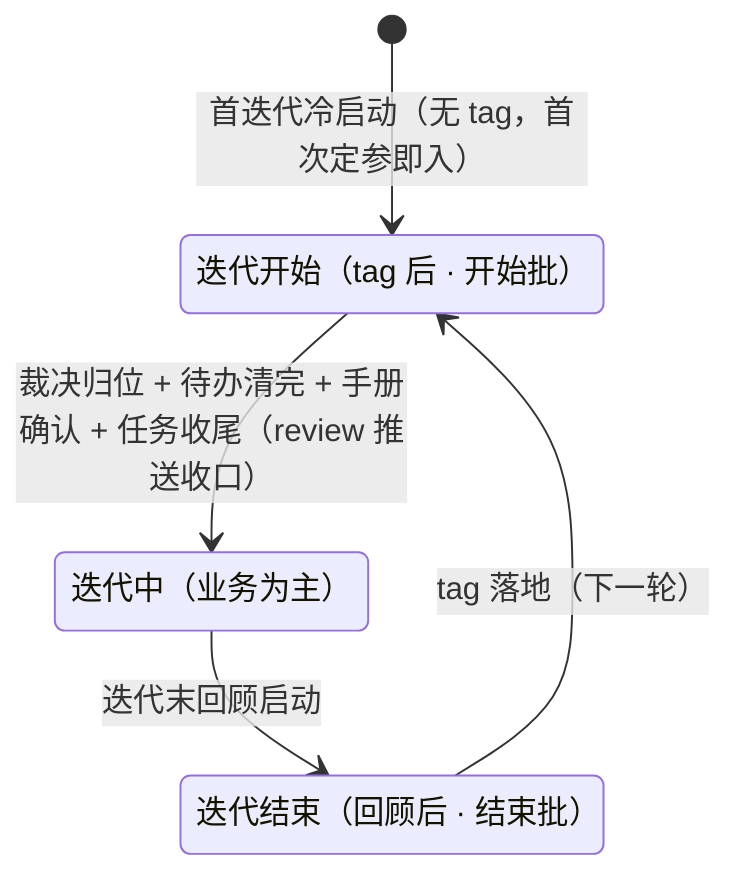

# Skill: sprint-iteration

> 本文是**迭代边界状态机**的单一真源：三态三转移、每态治理白名单、结束批（销账 + 收口 + tag 七门禁）、开始批（遗留裁决门 → 按裁决清白名单待办 → 手册定稿经操作者确认进迭代中 + review 提交推送收口）。WORKFLOW §2.7 只保留元状态定义与指针。与 retrospectives 的分工：本 skill 管**边界怎么过**，[`retrospectives/README.md`](../../../retrospectives/README.md) 管**回顾怎么做**（A 段步骤即收口清单本体）。**存在原因与设计取舍见 [`references/why-this-skill.md`](./references/why-this-skill.md)**——评估边界机制、与外部工作流对比、改动本 skill 前，先读该件。

## When（何时触发）

- **判态**：「当前迭代处于什么状态」「这个治理动作现在能做吗」——按下方状态机物证判态，再按白名单定归属。
- **结束批**：迭代末回顾启动后，执行销账 + 收口 + 打稳定 tag。
- **开始批**：稳定 tag 落地后，走新迭代准备直至开启手册定稿（裁决门 → 待办 → 定稿）。

## 状态机（三态三转移）

| 状态 | 治理白名单 | 出口锚（物证） |
| --- | --- | --- |
| 迭代开始（tag 后；首迭代无 tag = 定参后） | 仓库同步（repo-maintenance）/ 同事库对比（colleague-kb-synthesis）/ 学习源增量学习（预配置学习源，若有——锚点与登记见 [position/README.md](../../../position/README.md) 的 colleague / open-source 登记表）/ 遗留对账收尾 / 操作者定调的新迭代调整 | 遗留裁决门 → 按裁决清白名单待办 → 手册定稿 → 操作者确认（手册头部当前态改『迭代中』）→ 任务收尾 → review 提交推送 |
| 迭代中（业务为主） | 业务任务为主；治理诉求进 [BACKLOG](../../../BACKLOG.md) 攒批等下个结束批，操作者显式裁决可当期动 | 迭代末回顾启动 |
| 迭代结束（回顾后） | 回顾裁决事项销账（零悬空）+ 收口清单（走 retrospectives A 段），**收完才 tag** | tag 落地（即下一轮开始） |

- **判态 = 物证推断，不另存状态字段**（存出来的状态快照必过期）：tag 是否已打 = git tag 物证；手册是否确认 = 开启版产物与留痕；回顾是否启动 = 回顾任务立项 + 节点锚推进。
- **边界按归属与物证锚、不按日期**：迭代结束与开始可同日紧邻——回顾打 tag 与同步开始新迭代做调整是合法时序。

## 判态与体检（`/sprint-check`）

**判态三问**（按序命中即定，全部物证推断）：

1. 本迭代回顾已启动、新 tag 未打 → **迭代结束**（结束批进行中）；
2. 最近稳定 tag 已打、开启手册未确认（裁决未归位 / 待办未清 / 手册待确认或确认后未推送）→ **迭代开始**（开始批进行中；首迭代无 tag，以首次定参为开始锚、同判）；
3. 开启手册当前态 = 迭代中、回顾未启动 → **迭代中**。

物证取法：最近 tag = `git tag --list 'sprint-*' --sort=-creatordate` 首个（无 tag = 首迭代，开始锚 = WORKFLOW frontmatter 首次定参）；开始批进度 = 开始批任务 CURRENT（裁决归位行 + 待办执行留痕）；手册终态 = `position/snapshots/` 本迭代 `manual-sprint-<本轮>.html`（开启版）头部当前态；review 推送 = 开始批任务收尾 commit 是否已推送（远程分支含该批改动）；回顾启动 = 回顾任务立项 / retrospectives 节点锚推进。

**体检输出**（只读不改文件，判态后展开）：

- 判态结论 + 三项物证现状；
- 当前态白名单逐项对照：开始批白名单五项完成度（每项 已做 / 待做 / 待外部输入）+ 遗留裁决门状态（清单是否已呈报 / 裁决归位进度）；迭代中 = BACKLOG 本迭代攒批行数；结束批 = 收口动作集与 tag 七门禁逐门红绿（机器门禁项可现场跑 `workspace-check` 核实）；
- 三栏清单：**现在可做 / 待做（含前置）/ 当前态不该做**（属其他态或该攒批）；
- 带主题参数时附**归属判断**：该动作归 结束批 / 开始批 / BACKLOG 攒批——当下非法则明说，不顺手执行。

## 结束批（迭代结束态：回顾启动 → tag）

结束批改动面大，按**系列任务模式**组织（判别与目录形态真源 = [`series-phase-task-manage`](../series-phase-task-manage/SKILL.md) skill，配对加载）——回顾任务 = 系列总目录（回顾启动即立项 `#workspace-optimize`，阶段位置表唯一活状态；步骤链进度逐项落 CURRENT，确认当前进度看任务即知），阶段 = 节奏与交付单元。

**阶段五段 × 步骤十六步，逐步处理——顺序即依赖，一步完成判据达标才进下一步（可跨会话，留痕即进度）；阶段出口节奏三形态（呈报分组时供操作者选，默认①）：① 逐段出口——每阶段收口 = AI 交付接续提示词 → 操作者开新会话走 workspace-review 按主题聚批 commit + push（不积大尾批）；② 相邻段配对——相邻两段共用一个 review 会话；③ 收口一次——阶段一~阶段四全部完成后一次 review；②③形态下 commit 仍按阶段主题分批不变、tag（第 16 步）打在收口 review 推送之后；各步细则走 [retrospectives README](../../../retrospectives/README.md) A 段对应步**：

**阶段一 · 销账批**

1. **回顾裁决事项销账（最重要，零悬空）**：从回顾产物（点名议程裁决 / 移交清单 / B 候选 / 任务登记项）提取**全部**裁决事项，逐项显式归位——**本批落地 / 转 BACKLOG / 移交操作者 / 改判不做**，四选一（观察项、下迭代续接项归「转 BACKLOG」）。**完成判据 = 无「裁决了但未归位」的悬空事项泄漏到 tag 后**。留痕 = retro 文件销账节（回顾有立项任务时可落任务 CURRENT）。

2. **锚定范围**：本迭代任务 + commit 范围。完成判据 = 范围锚定落档。

3. **钩子打捞**：待对账 + 定期项节奏核对（真源 = retrospectives A 段第 2 步）。完成判据 = 钩子清单处理完。

阶段出口：workspace-review 销账批 commit + push 落地。

**阶段二 · 清扫批**

4. **exps 毕业清单确认**：双通道候选 → 操作者确认执行。完成判据 = 毕业清单逐条处置。

5. **成熟度盘点收口**：定型 / 继续试行 / 退役，清单入 CHANGELOG 条目。完成判据 = 清单入条目。

6. **清扫**：废弃文案 / 溯源注记 / 隐性残余五形态 / 软链核销四类同批——各形态细则、保留原则与例外清单见 [retrospectives README](../../../retrospectives/README.md) A 段第 5 步。完成判据 = 四类逐一扫清。

7. **评分账迁档**：ARCHITECTURE §3/§4 → `archive/architecture/<迭代名>.md`（热层只留当前迭代行 + 最新收敛）。完成判据 = 迁档完成。

8. **知识库迭代复检**：git 探测 + 分域锚点抽核，漂移即修并刷新 `verified-at`（真源 = [WORKFLOW §5.2](../../../WORKFLOW.md)「知识时效与迭代复检」）。完成判据 = 复检跑完。

9. **subAgent 复查**（大批量清扫 / 整改后）：只读三路（语义保真 / 残留与归档对账 / 机制成文与记录）。完成判据 = 复查结论处置完。

阶段出口：workspace-review 清扫批 commit + push 落地。

**阶段三 · 归档批**

10. **归档批次**：本轮全部**已完成**任务迁根级 `archive/<根>/`（范围判据与顺延任务例外见 [retrospectives README](../../../retrospectives/README.md) A 段第 6 步）+ 归档索引写入 `archive/<根>/INDEX.md` + 热层 INDEX 删行；**当场反查**活文档对已归档任务的路径引用，补 `archive/<根>/` 路径段。完成判据 = 归档零断链。

11. **定参 + 掉落改标**：下个 sprint-version 值 → WORKFLOW frontmatter `sprint-version`〔唯一真源，立项与改标取值皆源于此〕+ 周期 → 节点锚；**同场对本迭代裁决顺延的任务掉落改标**——`sprint-version` 改标新值 + `sprint-log` append 一段 + CURRENT 留痕一行（规则 = [WORKFLOW §2.7](../../../WORKFLOW.md) 掉落改标）。完成判据 = 定参落档 + 顺延任务改标零遗漏。

阶段出口：workspace-review 归档批 commit + push 落地。

**阶段四 · 产物批**

12. **第三方观察**：评分证据复核 + BACKLOG 体检 + 追认类当迭代落地，产物随同批 commit（观察机制建仓后规格见 `position/observations/README.md`；未建仓按此三件轻量执行）。完成判据 = 观察结论落盘。

13. **产物落盘**：retro 文件 + 节点锚 + 历次清单 + 分层快照（细则 = retrospectives A 段第 9 步）。完成判据 = 件齐——分层快照按**固定七层结构逐层填**（七层全景模型见快照模板），相邻快照做章节级 diff（逐层承前启后对照）。

14. **手册汇总版刷新**：`manual-sprint-<本轮>.html` 落 `position/snapshots/`——开始批已生成开启版，此处吸收本迭代业务实绩刷新为汇总版，**说明本迭代治理与更新产生的变化**。完成判据 = 汇总版 tag 前落档、与 tag 同锚；**业务轴四层按固定指标清单逐层填并逐层自检**（清单与口径定义一处真源沉淀，无则随首份手册建立；层间口径不互推——①量交付活动 ②量能力资产 ③量底座 ④量风险姿态；职责能力维量能力存量与增量，任务种类与件数不作能力证据，「无 / 入队待落」如实记）。
    - 面向零基础操作者的全量手册，结构固定八章（这是什么 / 五分钟开始 / 最少必要概念 / 日常交互 / 信任边界 / 生命周期 / 当前机制与状态 / 产物地图）——本迭代机制全定型（成熟度盘点完成）、数据画像与观察已落盘，此点生成即「本轮真实全貌」；
    - 跨迭代手册 diff **取汇总版序列互比**（本轮汇总版 ↔ 上轮汇总版）= 机制与交互演进 + 业务能力变化双轴对比（业务轴 = 四层分层对比，与分层快照的数据画像视角同锚互补；开启版/汇总版分工见开始批节）。

阶段出口：workspace-review 产物批 commit + push 落地。

**阶段五 · tag 批**

15. **终检推送齐**：核对全部阶段出口推送落地（远程分支含各阶段 commit）+ 工作区 clean + `workspace-check` 全量 `errors=0`；有残留改动补一批收尾 commit + push（任务收尾门禁前置：沉淀询问 + 机检先过）。完成判据 = 推送齐、零残留。

16. **打稳定 tag**：tag 打在未收完的内容上即失真——七门禁全绿才打（见下），且打在全部阶段推送之后的 commit 上。完成判据 = tag 落地 = 下一轮开始（下一轮开始批步骤链的入口）。

**tag 七门禁**（全绿才打；annotated tag、message 记定型/试行清单 + CHANGELOG 指针；push 用显式 refspec 且经授权；操作者可随时按同门禁独立发起，迭代末是默认锚非唯一窗口——独立发起时「A 段收口清单走完」门禁退化为「本次收口覆盖的 CHANGELOG 条目齐」）：

1. retrospectives A 段收口步骤（锚定范围至定下迭代参数，不含打 tag 与产物落盘本身）走完且本迭代 CHANGELOG 条目齐；
2. 回顾裁决事项销账零悬空（全部归位，四选一口径见阶段一步 1）；
3. 成熟度盘点完成（清单入条目）；
4. 清扫完成（废弃文案 + 溯源注记）；
5. `workspace-check` 全量 `errors=0`；
6. 工作区 clean（无未提交改动）且全部阶段出口推送已落地（远程分支含各阶段 commit）；
7. tag 指向 commit 有对应 CHANGELOG 条目。

**commit 形态 = 阶段即主题批**（销账批 / 清扫批 / 归档批 / 产物批 / tag 批），阶段内可再细分 commit、不设数字硬线。

## 开始批（迭代开始态：tag 后 → 手册确认 + review 推送）

tag 落地即进入（物证推断，无需显式发起；首迭代无 tag——首次定参即进入，步骤链相同），做面向未来的准备。开始批默认立项 `#workspace-optimize` 任务承载——步骤链进度逐项落任务 CURRENT，确认当前进度看任务即知。**步骤链六步，逐步处理——每步有自己的完成判据，一步判据达标才进下一步（可跨会话，留痕即进度）；各步做完即止（不无限延伸）**：

1. **遗留裁决门**：呈报上迭代结束留下的问题清单，操作者逐项裁决、真确认——裁决同时定步骤 2 白名单①-④的处置（现在做 / 择机 / 本次不做）。**完成判据 = 裁决逐项四选一归位（当批执行 / 转 BACKLOG / 移交操作者 / 改判不做，同结束批销账口径），未归位不进步骤 2**。留痕 = 开始批任务 CURRENT 裁决归位行。
    - 清单来源与覆盖下限：回顾移交区（retro 顺延任务开工闸门 / 观察项 / 操作者行动项）/ BACKLOG 已确认排期候选（本迭代排批件）/ 观察结论中需操作者定节奏的项；
    - 呈报口径（操作者决策减载）：清单与**本轮开启手册（或其要点）同场呈报**，逐项带默认处置与依据（AI 建议），可整体按建议通过、也可逐项改判；temp/todo 类操作者自发事项不列入呈报；呈报中的编号/代号一律自带语义（标题 + 一句上下文），禁裸编号。

2. **按裁决回补白名单待办**：执行裁决圈定的待办——① **仓库同步**（repo-maintenance，业务开发的代码基线）；② **同事库对比**（colleague-kb-synthesis，增量对比拿新迭代参考输入）；③ **学习源增量学习**（预配置学习源，若有——锚点与登记见 [position/README.md](../../../position/README.md) 的 colleague / open-source 登记表）；④ **遗留对账收尾**（上迭代「待对账」钩子捞起的核验任务）；⑤ **操作者定调的新迭代调整**（显式立项的机制 / 方向调整，走各自执行流）不依赖裁决、可在批内先行。判「本次不做」的项记档跳过。**完成判据 = 待办全部清完或记档跳过，无悬空**。留痕 = 各项执行留痕（任务 CURRENT）。

3. **开启手册定稿**：按裁决定稿，show-me 生成——开启版结构 = 驾驶篇 + 全量八章一体（见下方 snapshots 手册产物节），底稿 = 上轮汇总版 + 本开始批增量，落 `position/snapshots/`。**完成判据 = 开启手册落档**。

4. **操作者确认（确认闸门）**：呈报开启手册，操作者确认完才把手册头部当前态改「迭代中」（状态机态以步骤 6 推送落地为关门物证——确认后未推送仍判迭代开始，见判态三问 Q2）；明说「再改 / 再议」则停留迭代开始态继续修订（回到步骤 3）。**完成判据 = 确认留痕 + 手册头部当前态 = 迭代中**。此后迭代中**不再滚动更新手册**（实时状态在任务 CURRENT 与 /sprint-check，手册只在边界时点刷新）。

5. **任务收尾（两道门禁，真源 = AGENTS「开工与收尾」收尾门禁）**：沉淀询问（[WORKFLOW §2.4](../../../WORKFLOW.md) 逐条提议，答「没有」跳过；同场反查 BACKLOG 落地即销账）+ `workspace-check` 全量 `errors=0`（**先机检后翻转**）→ 任务翻 `已完成`。**完成判据 = 门禁留痕 + 任务 `status: 已完成`**。

6. **workspace-review 提交推送**：AI 交付接续提示词，操作者开新会话走 workspace-review 把开始批全部改动（含任务终态文件）按主题提交推送。**完成判据 = 推送落地（远程分支含该批 commit）= 新迭代开始的物证锚**——未推送前开始批成果仍悬在工作区，迭代边界未关门（六步齐 = 开始批收口）。

**snapshots 手册产物（每迭代两件，同名双时点）**：`manual-sprint-*.html` 一名两版——开启版 + 汇总版，两序列各自跨迭代对比。

- **开启版（开始批 · 初版）= 驾驶 + 全量一体**：驾驶篇置前（这轮流程变了什么 / 三阶段操作分工 / 你的决策队列 / 试行清单 / 产物地图，吸收裁决结果）+ 全量八章（零基础操作者入口）——开启迭代一份在手；底稿 = 上轮汇总版 + 本开始批增量，经操作者确认闸门后不再滚动更新。
- **汇总版（结束批 · 终版）= 全量八章刷新**：吸收本迭代业务实绩，汇总本迭代治理与更新产生的变化；tag 前落档，锚定本轮真实全貌。
- 跨迭代 diff **同序列互比**：开启版比开启版（迭代准备期的机制与交互演进）、汇总版比汇总版（含本迭代业务实绩的全貌演进）。
- 手册数字画像按**固定指标清单**填现值（清单与口径定义一处真源，无则随首份手册建立）：开启版口径 = 承前迭代总结 + 本开始批增量、汇总版口径 = 本迭代总结——同序列互比的两期必须同清单同口径，diff 呈现 = 指标逐行对齐 + 叙述摘要（整章换血形态退役）。
- 交互模型注意：操作者只做自然表达（直接纠正 / 想改就立项——显式立项不受迭代机制约束），归因、记录、建议是 AI 职责，不把机制口令包装成操作者负担。
- 落点边界 = `position/snapshots/`（常驻家；skills INDEX show-me 注脚的登记例外——HTML 默认落 temp/ 的通例不适用本产物）。

## Verify（DoD）

- 结束批：销账清单逐项归位可查 + 汇总手册落 `position/snapshots/` + 全部阶段出口推送落地（远程分支含各阶段 commit）+ 七门禁全绿打 tag（门禁留痕记任务 CURRENT）。
- 开始批：白名单项执行留痕 + 遗留裁决逐项归位留痕（含①-④处置）+ 裁决决定的待办项执行留痕 + 开启手册（驾驶 + 全量一体）产物落 `position/snapshots/`（操作者确认后当前态 = 迭代中）+ 任务收尾门禁留痕（沉淀询问 + 机检 `errors=0` 先过再翻已完成）+ workspace-review 提交推送留痕（新迭代开始物证，任务终态在内）。
