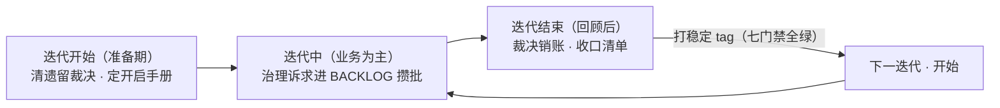

# GUIDE — 模板适配指南

本工作区是**业务中立的模板**：工作流机制已定型，业务内容全部用占位承载。按本文顺序完成适配（环境与仓库 → 五类任务接入 → 首任务验证），即可把模板变成你自己的工作区。

> **快速通道**：对 AI 说「新手引导」或发 `/guide`——AI 先做场景检测：新 clone 可选**最小启动道**（定调 + 两处核心占位 + `#tech` 首跑即可开工，其余后补）或**完整道**（环境与仓库 → 占位落填 → 首任务验证 → 适配摘要 → 用后退役本文）；已有工作区遇新增信号只跑增量差集。想手动适配的按本文顺序走。

**全文占位统一标记 `【模板占位…】`**，一条命令找到所有待填点（总表见 §4）：

```bash
grep -rn "【模板占位" --include="*.md" .
```

## 1. 环境与仓库（关键业务引导）

**先定调（业务范围三选一）**：本工作区只服务**某个业务**、一条**产品线**、还是**公司全业务**？——决定角色定位措辞（README 首行）、仓库清单与 `notes/` 的组织粒度（按业务 / 按产品 / 按部门）。新手引导（`/guide`）把这作为第一问。

先接通两样东西，AI 才能真正干活：**凭证环境**（查工单/日志/DB 等外部系统用）与**代码仓库**（开发/排查/咨询的对象）。只想先试工作流？两者都可跳过，直接发 `#tech`（§2.1）。

### 1.1 环境（凭证与密钥）

- **密钥单一真源 `.env.local`**（不进 git）：`cp .env .env.local` 后按注释填真实值。AI 只「加载」不「读取」（红线见 `.tools/env/README.md`）——密钥永远不经 AI 手，由你直接编辑。
- **代码托管平台访问**：建议用 **personal access token** 并从**最小 scope（只读）起步**，按需再扩；token 只进 `.env.local` 或你的 git credential helper（由你控制，AI 不持有凭证）。外部 API 类脚本一律强制 TLS + 最小 scope（规格见 AGENTS「工具安全」）。
- 纯任务协作零凭证可起步，上手机会成本极低。

### 1.2 仓库（业务代码接入）

- **登记**：`reference/repos.md` 填你的仓库清单（地址、默认分支、标签；人类主写，AI 靠它定位代码）。
- **接入**：把仓库 **clone 进 `src/<namespace>/<repo>/` 即授权 AI 在该目录工作**（AI 只 clone/pull/编辑，不 commit/push）。已有代码目录不想挪？并存 / junction 两种接法见 [HUMAN](./HUMAN.md) §0.4。
- **分支约定**：各仓基准分支家族约定已内置 [reference/branch-flows.md](./reference/branch-flows.md)（通用 flow 两档 + 各仓登记表）——**各仓条目按你的仓库落填**，AI 判定开发分支以它为真源。
- clone 后可用 `agents-md-refiner` skill 从代码提炼各仓 `AGENTS.md` 项目规范，AI 访问该仓时优先读。

> 业务侧最快落地的两处核心占位：`README.md` 首行角色定位、`AGENTS.md` 首段业务领域（= 新手引导「最小启动道」的两处）；`notes/` 首篇业务术语建议尽早建立（AI 遇到不理解的术语会先查这里）。全部待填点见 §4。

## 2. 五类任务：简要教程与接入建议

通用形态：消息**开头**打标签 → AI 立项建目录 → 按对应执行流 skill 走（Lifecycle/门禁见各 SKILL.md）。按上手顺序排列。

### 2.1 `#tech` 技术咨询（推荐首跑）

- **是什么**：问业务/技术问题，AI 澄清 → 知识库分层查证（`notes/`/`reference/`/`exps/`；涉及「系统当前如何运行」回 `src/` 代码核实）→ 产出 `answer.md`（结论先行）。
- **示例**：`#tech XX 模块的缓存策略是什么，现在生效的是哪种`
- **接入建议**：零前置。跑通即说明工作区就绪（完整就绪判据另含全量机器检查 `errors=0`——走新手引导会自动跑，手动适配可自己跑 `python .tools/workspace-check.py`）。

### 2.2 `#research` 需求调研

- **是什么**：方案选型/调研类问题，AI 定边界 → `src/` 代码锚定现状（无实现也是结论）→ `refs.md` 收集 + `report.md` 方案对比与建议。
- **示例**：`#research 导出功能选型：自研还是复用现有组件，给对比和建议`
- **接入建议**：`repos.md` 已登记 + 相关仓已 clone 时结论更扎实；无代码也能跑。

### 2.3 `#case` CASE 排查

- **是什么**：售后问题排查——先锁失败接口、区分已确认事实与高可信假设、证据闭环（宣称「已确认根因」必过证据门槛）。
- **示例**：`#case 用户反馈下单后订单状态未更新，帮我排查`
- **接入建议**：问题**来源渠道不限**——售后消息群报障、邮件、工单都是合法来源，把来源与信息（单号 / 链接 / 聊天记录要点）记进任务 README 即可；想让 AI 直接查工单（**任一任务类型可用**，见 §3.4 可选增强）。

### 2.4 `#feat` 需求开发

- **是什么**：全链开发流——规格判定（五维两档）→ 全景调研 → plan 经你确认才编码 → 交付四件套 → 审核子协议 → 验证三分法（五态 Lifecycle）。
- **示例**：`#feat 给导出接口做异步化改造`
- **接入建议**：前置 = 相关仓已 clone 进 `src/`（§1.2）+ 分支约定可判定；开发在独立 worktree 进行（AGENTS「代码视图隔离」）。

### 2.5 `#workspace-optimize` 工作区迭代优化

- **是什么**：工作区自身治理/维护/学习类任务（定期维护菜单真源 = `workspace-ops` skill，随其演化；业务工作不走此标签）。
- **示例**：`#workspace-optimize 审视工作流`（workspace-grill 只读审计——也是比 `#tech` 更完整的就绪验证路径）

### 2.6 产物速查（一个任务最终长什么样）

| 任务 | 核心产物 | 模板 / 格式真源 |
| ---- | -------- | --------------- |
| `#tech` | `answer.md`（结论先行） | tech-consult SKILL（格式内含，无独立模板） |
| `#research` | `report.md` + `refs.md` | research-survey SKILL（格式内含） |
| `#case` | 任务 README conclusion（六分区）+ 可选 `customer-report.md` 对客回复 | case-troubleshoot `references/customer-report.md` |
| `#feat` | design / 交付四件套（大需求另有契约快照） | feat-plan-research `references/`（design-mapping / contract-snapshot 等模板） |
| `#workspace-optimize` | 任务 README / CURRENT + 对应机制产物 | workspace-ops 与各机制 skill |

本表是**指针索引**——模板本体在各 skill `references/` 下随用随取，不复制第二份（单一真源）。

## 3. 其他

### 3.1 模板从哪来（演进关系）

本模板反哺自一个实战工作区——所有机制（执行流 skill、状态机、收尾门禁、经验毕业等）都经过真实任务验证，不是纸面设计。模板主本与源工作区保持**定期增量学习循环**（源侧稳定版锚定对比 → 增量研判 → 裁决落地），演进双向——模板侧的机制改进也会回流源侧；你 clone 到的机制版本即该循环的最新产出。模板线**独立演进**：你 clone 后就是你的独立仓库，与源工作区互不合并；想借鉴对方的后续改进，走「对比借鉴」方式人工挑选落地，不直接 merge（你的改进想回流源仓：提 PR 作同事库参考，机制见 [CONTRIBUTE.md](./CONTRIBUTE.md)）。想做得更系统时，用**双维度对比框架**：工作流范式逐维比对（组织主轴、任务与流程管理、真源观念、代码与提交策略、技能加载、防膨胀与可发现、沉淀时机、安全边界）+ 知识侧重（内容分布、抽象层级、实证密度），产出**三向判定**（他有我无 / 我有他优 / 双方等价）——领先面与等价面同样值得确认，防「只看缺漏」的单向视角。

### 3.2 能力总览

**已内置**（`#workspace-optimize` 维护菜单可触发；下表为菜单中的多步骤执行流类能力，全量清单真源 = [`workspace-ops` skill](./.agents/skills/workspace-ops/SKILL.md) 维护菜单——[HUMAN](./HUMAN.md) §2 只承载人类入口）：

| 能力 | 是什么 | skill |
| ---- | ------ | ----- |
| 学习外部工作区（同事库对比） | 主动学习一个**有**演进历史（CHANGELOG + 任务历史）的外部工作区：双维度对比（工作流范式 + 知识组织）→ 借鉴清单（带演进证据）→ 你逐条裁决分流；同事库/开源参照可先登记 `position/` | `colleague-kb-synthesis` |
| 知识库加固 | 用已结 CASE/需求素材系统性反哺 `notes/`：**先盲判后对照**（AI 先凭现有知识给链路结论，再对照素材与代码核实），盲点优先沉淀成坑 | `notes-reinforcement` |
| 维护仓库 | `src/` 仓库五阶段维护（对账 / 同步 / 发现 / clone / 迁移，各阶段独立授权）；配套脚本与内网平台【模板占位】，按你的环境落地后全量启用 | `repo-maintenance` |
| skill 市场巡检 | 定期扫外部 skill 市场找提效候选（三源取数 + 画像预筛）产出候选清单——命中后走 skill 选型评估（下表）深析 | `workspace-ops` skill 菜单 |

学习外部工作区**只分析不自动落实**（外部路径 = 只读授权、密钥载体不读取、沉淀过「来源中立」转换）；知识库加固经操作者确认后写入 `notes/`。细节见各自 SKILL.md。

**配套能力**（随模板分发，语义命中自动触发）：

| 能力 | 是什么 | 入口 |
| ---- | ------ | ---- |
| 治理审计 | 三模式审视工作流（建议 / 决策 / 落地）；§2.5 的示例即「建议」模式 | `workspace-grill` skill |
| 工作区改动评审 | 本仓未提交变更的结构化评审 + 按主题拆 commit（每次 commit 前过 `--staged` 机器门禁） | `workspace-review` skill |
| 项目知识库 | `src/` 各项目知识库全生命周期（建库 / 增量更新 / 一致性校验，`/knowledge-*` 命令族；只管 `src/` 项目，工作区自身 `notes/` 走知识库加固） | `knowledge-base` skill |
| 项目 AGENTS.md | 分析代码提炼项目级开发约定，初始化 / 补全 / 精简各仓库 `AGENTS.md` | `agents-md-refiner` skill |
| 外部 skill 选型评估 | 给出 skill 仓库链接要求分析（「适不适合我们」「能不能直接用」）→ 初判 + 深析 + 可选实测 → 裁决留你 | `skill-fit-eval` skill |
| 外部文章分析 | 给出文章链接要求分析（「结合工作区看看有什么可沉淀」）→ 逐篇骨架提炼对照本区 → 三层结论 + 裁决点 | `external-article-analysis` skill |
| 方案压测 / 可视化 | grilling（relentless 追问压测 plan/design，见 §3.3）/ show-me（图表化讲解）；vendor 引进、`skills-lock.json` 锁版本随仓分发 | skills `INDEX.md`「vendor」节 |
| 迭代运营 | 迭代边界状态机（迭代开始 / 中 / 结束三态；结束批 = 回顾销账 + 收口清单 + 打稳定 tag 七门禁，开始批 = 手册定稿开迭代）——机制讲解见 §3.6 | `sprint-iteration` skill |
| 大任务系列容器 | 大需求按阶段拆系列目录：系列总目录管总体把控（四账 = 范围 / 分期 / 外部单据 / 遗留 + 阶段位置表），子阶段目录管交付与阶段出口门禁——「要不要分阶段」判别时点命中，与需求开发流配对 | `series-phase-task-manage` skill |
| 产图约定 | 图表选型判据（先定读者问题再选模型，八型）+ SVG / 手绘 HTML 绘图纪律——与 show-me 配对：show-me 管内容结构，本 skill 管选型与绘图纪律 | `diagram-conventions` skill |
| 平实度终检（去 AI 味） | 机检先行 + 词表判读 + 可选盲检的对外稿终检（裁决呈报 / 报告定稿前用） | `plainness-check` skill |
| 任务看板 | 会话内任务大盘：工作区全局状态投影，扫描即生成——零新状态、零新载体、零写入 | `workspace-kanban` skill |

命令入口：`.agents/commands/` 薄路由（`/workspace-optimize`、`/review`、`/workspace-check`、`/workspace-kanban`、`/knowledge-create` 等），与 skill 同源、不复制正文。

### 3.3 可选实践

- **position/（定位基准）**：模板已内置三件套——`README.md`（我是谁 / 初心 / 边界，给 AI 的行为锚，也是你自己做重大取舍时的对照基准）+ 同事库 / 开源参照登记表（`colleague.md` / `open-source.md`，清单人类维护）+ `compare/` 对比档案。先填定位基准，重大机制更新前先对照它，防借鉴偏移。
- **追问式压测（grilling）**：AI 给出 plan/design 后，若觉不妥，要求它「对我这个方案做一轮 relentless 追问式压测」——一问一答收敛后再动手，能显著减少返工。

### 3.4 可选增强：外部系统深度接入（工单 / 日志 / DB）

工单系统等外部系统接入是**增强型可选操作**，不是任何任务类型的前置：

- **谁都能用**：各任务类型都可查工单——CASE 报障单、`#feat` 需求单、`#tech` 咨询单，只是**工单类型不同**；不接入也不影响任何流程（信息手填进任务 README 即可）。
- **CASE 来源不限于工单**：售后消息群报障、邮件、口头反馈都是合法来源——工单只是其中一种载体；证据纪律（事实 / 假设分区）对任何来源一致。
- **两种接法**：**MCP 接入**（工单系统有 MCP server 配到 AI 工具项目级；没有可写 stdio↔HTTP 桥接脚本放 `.tools/`，token 从 `.env.local` 加载）；**CLI 封装**（查询 CLI + 配套 skill 触发语）。
- **接入后**：沉淀一个「<系统> 配对加载」类 skill（查询入口 + 展示规则单一真源），并在 AGENTS「skills 加载」登记配对约定。

### 3.5 换机器 / 新 clone

1. `cp .env .env.local`，按注释填真实值（没有可跳过）。
2. Windows + claude 工具用户：跑 `.tools/skill-bridge/` 的 junction 桥脚本重建 skills 链接（其他工具自动发现 `.agents/skills/`，无需处理）。
3. 打开 AI 工具对工作区发一个 `#tech` 任务验证（§2.1）。

### 3.6 迭代机制（可选启用：以固定窗口经营工作区）

**解决什么问题**：只有任务粒度的时间轴时，回顾没有节奏锚、归档没有固定时机、机制改进候选（BACKLOG）没有集中裁决的时点。迭代机制把工作区的经营节奏显式化：以固定窗口（周期你定，如两周）承载多个任务，窗口末统一回顾、归档、打版本锚。

**核心循环（三态，按物证判态不按日期）**：



**关键概念**：

- **迭代号 `sprint-version`**：格式 `YYYYMMDD`（该迭代的发布版本日）。当前值**唯一真源 = `WORKFLOW.md` frontmatter**；每个任务立项时在 CURRENT 标所属迭代——迭代末 `grep` 该字段即得本迭代全部任务。不另存迭代清单、不与你的项目管理系统双写（迭代规划归外部系统，落填点见 §4 总表 WORKFLOW §2.7 行；工作区只记「做了什么 + 做得怎样」）。
- **迭代末闭环**：回顾（七层清算）→ 能力评分收敛 → 定下迭代号与周期 → 掉落任务改标 → 打稳定 tag `sprint-<本轮>`（七门禁全绿才打，tag 即版本锚、也是下一迭代的开始物证）。
- **掉落改标**：没做完、顺延到下个迭代的任务，迭代末统一改标为新迭代号，并记轨迹 `sprint-log: 迭代A → 迭代B → …`（首段 = 立项迭代永不改；顺延几次就多几段）。
- **归档时机 = 回顾后**：已完成任务先留活跃区，迭代末随回顾统一归档——迭代期间 `grep` 迭代号才能拿到完整范围（进行中 + 已完成待回顾）。
- **BACKLOG 攒批**：迭代中不顺手改机制，治理候选进 [BACKLOG](./BACKLOG.md) 等迭代末集中裁决（操作者显式点名可当期动）。
- **迭代手册（manual-sprint-*.html）**：迭代边界的驾驶与全貌手册，存 `position/snapshots/`、开启版与汇总版两件（同名双时点）——开始批「定稿开启手册」即定此件（经你确认），其头部状态字段兼作判态物证。
- **分层快照（snapshot-sprint-*.md）**：回顾产出的七层结构状态锚（模板 [`snapshot-template.md`](./retrospectives/snapshot-template.md)），相邻快照章节级 diff 即快速版本差异分析。

**怎么运转**：首迭代冷启动 = 第一次回顾定下迭代号即开始锚（无 tag 起步合法）；日常任务立项自动带迭代号，随时 `/sprint-check` 判态体检（输出「现在可做 / 待做 / 当前不该做」三栏）；迭代末发起回顾（`#workspace-optimize`）走结束批，tag 落地自动进入下一轮开始批。

**采用判断**：团队有固定交付/发布节奏、需要定期回顾与治理收敛 → 启用；单人按需使用、无节奏诉求 → 整块跳过（任务不标迭代号，回顾与归档按需发起——WORKFLOW §2.7 豁免口径，机制本身仍随模板完整供给）。

**真源分工**：边界怎么过（三态白名单 / 结束批 / 开始批 / tag 七门禁）= [`sprint-iteration` skill](./.agents/skills/sprint-iteration/SKILL.md)；回顾怎么做（A 段步骤 / B 段七层清算）= [`retrospectives/README.md`](./retrospectives/README.md)；元定义 = [WORKFLOW §2.7](./WORKFLOW.md)。

## 4. 占位清单总表

| 位置 | 占位内容 |
| ---- | -------- |
| `README.md` 首行 + 文档地图 | 工作区角色定位（如「XX 业务后端工程师」）与仓库名 |
| `AGENTS.md` 首段 | 你服务的业务领域（如「音视频云服务」） |
| `reference/repos.md` | 你的业务仓库清单 |
| `reference/branch-flows.md` 各仓登记表 | 各仓 flow（centralized / mr-review / 自定义）+ 开发分支 + 分支家族一句话（AGENTS「代码视图隔离」的分支约定占位已由本文件兑现） |
| `workspace-code-setting/code-workspace-env/README.md` 映射 | worktree 环境文件铺装映射（本地开发所需不进 git 的环境文件，一行一仓；为空则跳过铺装）；模板与生成器说明见该目录 README |
| `notes/glossary.md`（待建） | 业务域词语契约表：业务定调后首次出现「同一事物多套叫法」返工时建——五列（推荐用语/定义/代码标识/易混词消歧/代码锚点）+ 禁用词清单附录 + 维护规则「新词先查表再造词」 |
| `WORKFLOW.md` §2.7 | 你的工单/项目管理系统名（迭代规划归它） |
| `WORKFLOW.md` frontmatter `sprint-version` | 当前迭代号（YYYYMMDD）——首次回顾定参后改写，此后为唯一真源（不执行迭代的团队可不填、整行删除并同步 §2.7；迭代机制讲解见 §3.6） |
| `retrospectives/README.md` 节点锚与历次清单 | 首个迭代号（YYYYMMDD）+ 周期 + 上次回顾 commit 锚 |
| `.env` 与 `.tools/env/README.md` | 按你的工具链增删 KEY（真实值只进 `.env.local`） |
| `HUMAN.md` §0.3 | 按需增强表（你环境里实际用到的凭证与工具） |
| `.agents/skills/case-troubleshoot` | 问题来源信息按实际渠道填写（工单 / 消息群 / 邮件等；工单深度接入 = 可选增强，见 §3.4） |

以 `grep -rn "【模板占位"` 为准（上表即全部待填落点；grep 另会命中的 skill / CHANGELOG 内字样是机制说明与历史叙事、非待填点；`.env` 非 md，单独看文件内注释）。
