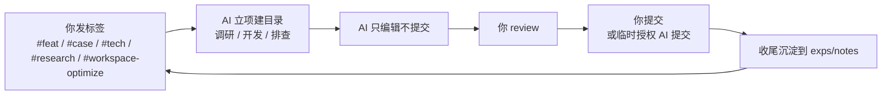

# Architecture-Engineer Workspace（架构工程师工作区）

一个**人 + AI 协作**的工作区，用 AI 辅助完成需求开发、CASE 排查、技术咨询、需求调研、工作区迭代优化。【模板占位：把「架构工程师」改成你的角色定位（如「XX 业务后端工程师」），并按需改仓库名】

> 这是**模板线**：机制来自一个实战工作区的验证沉淀，业务中立、开箱即配。**新用户先读 [GUIDE.md](./GUIDE.md) 完成适配**（填业务信息 → 接工单系统 → 跑首个任务）。

## 这是什么

把「**人是指挥、AI 是执行**」落成目录结构 + 工作流：

- **任务即目录**：需求→`story/`、排查→`case/`、咨询→`tech/`、调研→`research/`、操作→`workspace-optimize/`。
- **两道闸门在你手里**：① 计划（觉不妥可要求 AI 用追问式压测打磨设计）；② 代码（AI 默认不 `commit/push`，你 review 后手动提交，或临时授权 AI 提交）。
- **经验是副产品**：收尾把可复用结论沉淀到 `exps/`（经验）和 `notes/`（业务知识）。

五类任务：

| 标签                  | 任务类型       | 落地目录    |
| --------------------- | -------------- | ----------- |
| `#feat` / `#需求`     | 需求开发       | `story/`    |
| `#case` / `#排查`     | CASE 排查      | `case/`     |
| `#tech` / `#咨询`     | 技术咨询       | `tech/`     |
| `#research` / `#调研` | 需求调研       | `research/` |
| `#workspace-optimize` / `#工作区优化` | 工作区迭代优化 | `workspace-optimize/` |

## 从哪开始

| 你是             | 先读这个                 | 然后做                                                   |
| ---------------- | ------------------------ | -------------------------------------------------------- |
| **操作者（人）** | 首次 → [GUIDE.md](./GUIDE.md)；日常 → [HUMAN.md](./HUMAN.md) | §0 上手适配 → 日常发标签任务、定期维护                   |
| **AI（agent）**  | [AGENTS.md](./AGENTS.md) | 读角色 + 安全红线 → 按 [WORKFLOW.md](./WORKFLOW.md) 执行 |

## 顶层文档

| 文档                | 给谁        | 作用                                       |
| ------------------- | ----------- | ------------------------------------------ |
| README.md（本文档） | 所有人      | 入口与导航                                 |
| GUIDE.md            | 新用户      | 模板适配指南（填业务 / 接工单 / 跑首个任务） |
| HUMAN.md            | 操作者      | 上手与操作 SOP                             |
| AGENTS.md           | AI          | 角色定义、安全红线、行为准则（AI 上下文）  |
| WORKFLOW.md         | AI          | 任务运转指令（分流 / 执行 / 收尾）         |
| reference/repos.md  | 所有人      | 业务代码仓库清单【模板占位：填你的仓库】   |
| CHANGELOG.md        | 所有人      | 工作区变更日志                             |
| BACKLOG.md          | 所有人      | 待验证改进                                 |

## 目录结构

| 目录                                         | 用途                                                   | 谁维护                       |
| -------------------------------------------- | ------------------------------------------------------ | ---------------------------- |
| `.agents/skills/`                            | 项目 Skill（任务语义命中时加载）                       | AI                           |
| `.tools/`                                    | 脚本与工具（环境校验、密钥加载等）                     | AI（人类授权）               |
| `story/` `case/` `tech/` `research/` `workspace-optimize/` | 五类任务产物（按标签分流）                             | AI + 人类 review             |
| `exps/`                                      | 可复用经验与方法论                                     | AI                           |
| `notes/`                                     | 业务与技术知识                                         | AI                           |
| `reference/`                                 | 代码开发参考（仓库清单、架构规范）                     | **人类主写**，AI 经授权辅助  |
| `src/`                                       | 业务代码项目（clone 即授权，不进 git）                 | AI 只编辑                    |
| `temp/`                                      | 临时输出（不进 git，用完即清）                         | AI                           |
| `retrospectives/`                            | 阶段回顾存档（锚定迭代）                               | AI + 人类 review             |
| `workspace-grills/`                          | 工作区治理审计决策记录（冷层）                         | AI + 人类 review             |

## 快速索引

- 适配模板（新用户） → `GUIDE.md`
- 查仓库 → `reference/repos.md`
- 查经验 → `exps/INDEX.md`
- 查业务知识 → `notes/INDEX.md`
- 查回顾 → `retrospectives/README.md`
