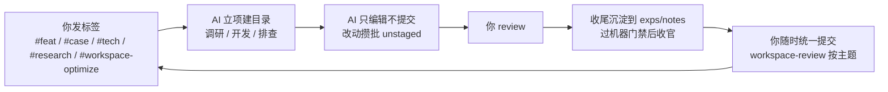

# Architecture-Engineer Workspace（架构工程师工作区）

一个**人 + AI 协作**的工作区，用 AI 辅助完成需求开发、CASE 排查、技术咨询、需求调研、工作区迭代优化。【模板占位：把「架构工程师」改成你的角色定位（如「XX 业务后端工程师」），并按需改仓库名】

> 这是**模板线**：机制来自一个实战工作区的验证沉淀，业务中立、开箱即配。**新用户先读 [GUIDE.md](./GUIDE.md) 完成适配**（环境与仓库 → 五类任务接入 → 首任务验证），或直接对 AI 说「新手引导」/ 发 `/guide` 让它带你一次走完。

## 5 分钟跑通第一个任务

1. 对 AI 说**「新手引导」**（或 `/guide`），选**最小启动道**——定调业务范围 + 填两处核心占位即可开工，其余全部后补；不想引导，说「跳过」也行。
2. 发第一个任务：`#tech <任意真实业务问题>`（示例见 [GUIDE](./GUIDE.md) §2.1）。
3. 跑通 = 工作区就绪（引导会自动跑机器检查）；接代码仓库 / 工单系统等增强见 [GUIDE](./GUIDE.md) §1。

## 这是什么

把「**人是指挥、AI 是执行**」落成目录结构 + 工作流：

- **任务即目录**：需求→`story/`、排查→`case/`、咨询→`tech/`、调研→`research/`、操作→`workspace-optimize/`。
- **两道闸门在你手里**：① 计划（觉不妥可要求 AI 用追问式压测打磨设计）；② 代码与提交——`src/` 业务代码由你 review 后提交或单批临时授权 AI 提交；本工作区仓的改动攒批保持 unstaged，你随时开一个统一会话走 [workspace-review](./.agents/skills/workspace-review/SKILL.md) 按主题提交（AI 收场只做评审修复自检，不提议提交）。
- **机器门禁托底**：任务收尾与 commit 各一道机器检查（`.tools/workspace-check.py --task` / `--staged`，`errors=0` 才放行；lint / 任务状态机 / 链接 / 密钥扫描一体）；仓库另带 CI（`.github/workflows/`，个人工作区不需要可删）。
- **经验是副产品**：收尾把可复用结论沉淀到 `exps/`（经验——判断型专属暂存区，成熟后毕业为 checklist / 规则 / 知识库）和 `notes/`（业务知识）。
- **迭代可选**：以固定窗口经营工作区——任务标迭代号，迭代末回顾销账、顺延任务掉落改标、打稳定 tag 锚版本，治理候选攒批到迭代末集中裁决（机制讲解见 [GUIDE](./GUIDE.md) §3.6）；不跑迭代的团队整块跳过（WORKFLOW §2.7 豁免口径）。

五类任务：

| 标签                  | 任务类型       | 落地目录    |
| --------------------- | -------------- | ----------- |
| `#feat` / `#需求`     | 需求开发       | `story/`    |
| `#case` / `#排查`     | CASE 排查      | `case/`     |
| `#tech` / `#咨询`     | 技术咨询       | `tech/`     |
| `#research` / `#调研` | 需求调研       | `research/` |
| `#workspace-optimize` / `#工作区优化` | 工作区迭代优化 | `workspace-optimize/` |

## 从哪开始

| 你是             | 先读这个                 | 然后做                                                   |
| ---------------- | ------------------------ | -------------------------------------------------------- |
| **操作者（人）** | 首次 → [GUIDE.md](./GUIDE.md)；日常 → [HUMAN.md](./HUMAN.md) | §0 首次上手 → 日常发标签任务、定期维护                   |
| **AI（agent）**  | [AGENTS.md](./AGENTS.md) | 读角色 + 安全红线 → 按 [WORKFLOW.md](./WORKFLOW.md) 执行 |

## 顶层文档

| 文档                | 给谁        | 作用                                       |
| ------------------- | ----------- | ------------------------------------------ |
| README.md（本文档） | 所有人      | 入口与导航                                 |
| GUIDE.md            | 新用户      | 模板适配指南（填业务 / 接工单 / 跑首个任务） |
| HUMAN.md            | 操作者      | 上手与操作 SOP                             |
| AGENTS.md           | AI          | 角色定义、安全红线、行为准则（AI 上下文）  |
| WORKFLOW.md         | AI          | 任务运转指令（分流 / 执行 / 收尾）         |
| ARCHITECTURE.md     | AI + 操作者（收尾反问 / 迭代末评分） | 架构共识与能力反馈评分（触发点表真源 §5） |
| reference/repos.md  | 所有人      | 业务代码仓库清单【模板占位：填你的仓库】   |
| CHANGELOG.md        | 所有人      | 工作区变更日志                             |
| BACKLOG.md          | 所有人      | 待验证改进                                 |
| CONTRIBUTE.md       | 外部 fork 用户 | 贡献与分发机制（fork 分发 · PR 作同事库参考回流，不直接合入） |

## 目录结构

| 目录                                         | 用途                                                   | 谁维护                       |
| -------------------------------------------- | ------------------------------------------------------ | ---------------------------- |
| `.agents/skills/`                            | 项目 Skill（任务语义命中时加载）                       | AI                           |
| `.tools/`                                    | 脚本与工具（一致性检查 workspace-check、密钥加载、skills 桥等） | AI（人类授权）               |
| `story/` `case/` `tech/` `research/` `workspace-optimize/` | 五类任务产物（按标签分流）                             | AI + 人类 review             |
| `exps/`                                      | 可复用经验与方法论                                     | AI                           |
| `notes/`                                     | 业务与技术知识                                         | AI                           |
| `reference/`                                 | 代码开发参考（仓库清单、架构规范）                     | **人类主写**，AI 经授权辅助  |
| `src/`                                       | 业务代码项目（clone 即授权，不进 git）                 | AI 只编辑                    |
| `position/`                                  | 定位基准与对比参照登记（同事库/开源参照清单 + compare 对比记录） | 清单人类维护、记录 AI        |
| `temp/`                                      | 临时输出（不进 git，用完即清）                         | AI                           |
| `archive/`                                    | 全工作区唯一归档根（`archive/<根>/` 任务冻结树 + 归档索引，冷层） | AI + 人类 review             |
| `retrospectives/`                            | 阶段回顾存档（锚定迭代）                               | AI + 人类 review             |
| `workspace-grills/`                          | 工作区治理审计决策记录（冷层）                         | AI + 人类 review             |
| `workspace-code-setting/`                     | worktree 工作区与着陆卡（任务子窗口读到的最低硬规则卡）模板真源（生成器 `.tools/sync-worktree-workspace.py` 消费） | AI（人类授权）               |

## 快速索引

- 适配模板（新用户） → `GUIDE.md`
- fork 参与与改进回流 → `CONTRIBUTE.md`
- 查仓库 → `reference/repos.md`
- 查经验 → `exps/INDEX.md`
- 查业务知识 → `notes/INDEX.md`
- 查回顾 → `retrospectives/README.md`
