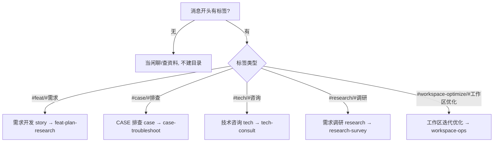

# 工作流（WORKFLOW）

本文档是工作区的**运转指令**。所有任务按本文档分流、执行、收尾。
配套阅读：角色与目录职责见 [AGENTS.md](./AGENTS.md)，安全红线见 [AGENTS.md](./AGENTS.md)「安全红线」小节，新用户适配见 [GUIDE.md](./GUIDE.md)。

---

## 0. 总则

1. **权限边界（最高优先级）**：工作区是**上下文洁净区**，默认只能在其内部读写；访问外部（路径/网络/凭证）默认禁止，**经操作者授权可临时放开**。详见 [AGENTS.md](./AGENTS.md)「安全红线」。授权的物化形式之一：操作者把目标仓库 clone 进 `src/`，即视为授权 AI 在该目录工作。
2. **任务即目录**：每接到一个任务，先判断类型，再在对应根目录下建一个**任务目录**承载全部过程与产物。
3. **代码不入版本库**：具体项目代码统一放在根 `src/`（每项是独立 git 仓库，已被 `.gitignore` 忽略），文档资产放在各任务目录内。
4. **reference 以人类编写为优先**：`reference/` 由人类主写、AI 辅助；**AI 经授权后才能写入**（默认只读）。`notes/` 内容若已能覆盖 `reference/` 某篇，可向人类提出下线建议。
5. **按价值沉淀，非必留痕**：只有可复用的结论才进 `exps/`/`notes/`；新增前先查能否并入既有条目，能合并则不新增。膨胀治理见 §2。
6. **人在环中（两道闸门）**：①**计划**——操作者若觉不妥，可要求 AI 对 plan/design 做**追问式压测（grilling 协议）**后再动手；②**代码**——AI 默认只 `clone`/`pull`/编辑，**`commit` 与 `push` 一律不自行执行**；但**代码 review 通过后 AI 可主动询问操作者是否授权**（逐任务、一次性授权），获授权后执行 `commit` + `merge --ff-only`（不可 FF 则 rebase 再 FF）+ `push`，执行后恢复默认限制。未获授权则由人类自行完成。

---

## 1. 通用约定

### 1.1 任务目录命名

统一格式：`<根目录>/<类型前缀>-<YYYY-MM-DD>-<简短英文 kebab-case 描述>/`

| 任务类型  | 根目录      | 类型前缀   | 示例                                                |
| --------- | ----------- | ---------- | --------------------------------------------------- |
| 需求开发  | `story/`    | `feat`     | `story/feat-2026-07-04-order-export/`               |
| CASE 排查 | `case/`     | `case`     | `case/case-2026-07-04-api-timeout/`                 |
| 技术咨询  | `tech/`     | `tech`     | `tech/tech-2026-07-04-cache-strategy/`              |
| 需求调研  | `research/` | `research` | `research/research-2026-07-04-vendor-selection/`    |
| 工作区迭代优化 | `workspace-optimize/` | `task` | `workspace-optimize/task-2026-08-09-sync-colleague/` |

> 日期使用创建当天的日期；描述用小写英文连字符，便于排序与检索。

### 1.2 文档命名

- `README.md`：任务目录入口，必填，含背景与索引。**不承载运行时 `status`**（status 唯一在 `CURRENT.md`，见 §2.6）；**唯一例外**——已完成任务可在 README 标 `status: 已完成` 作归档辨识（可选，非必须）。H1 记任务目录名（定位锚，防标题与目录名漂移断追溯）；机检已开（workspace-check：未完成任务 README 首 H1 须含目录名，无 H1 同报；已完成 README 冻结与 archive 豁免，存量未完成已同步回填；**reopen 翻回 `进行中` 即恢复强制**）。
- 其余按 §3 执行流路由表指向的 skill 所规定产物命名（`plan.md`、`analysis.md`、`report.md` 等）。
- 全部 Markdown，2 空格缩进、LF、UTF-8（遵循 `.editorconfig`）。

### 1.3 任务入口与分流

**入口规则（防污染闸门）**：任务靠**消息开头的标签**显式声明；**无标签 = 闲聊/查资料，AI 绝不建任务目录**。标签必须是消息的**第一个 token** 才生效（句中出现不识别）。

**立项粒度（一个工作批次一个总 task）**：同一会话/同一主题的连续工作 = **一个总 task**。总 task 进行中产生的新方向（子任务/增项）作为**内部增项**承载（README 加「子任务/增项」章节 + CURRENT 统一记进度），**不立新 task**；只有**完全独立的新主题**才立新 task。判据：新方向与进行中 task 是否**同主题**？是 → 增项（内部承载）；否 → 立新 task。

| 标签（英 / 中）       | 任务类型       | 落地目录                | 执行流 skill（单一真源）                                     |
| --------------------- | -------------- | ----------------------- | ------------------------------------------------------------ |
| `#feat` / `#需求`     | 需求开发       | `story/feat-...`        | [`feat-plan-research`](./.agents/skills/feat-plan-research/SKILL.md) |
| `#case` / `#排查`     | CASE 排查      | `case/case-...`         | [`case-troubleshoot`](./.agents/skills/case-troubleshoot/SKILL.md) |
| `#tech` / `#咨询`     | 技术咨询       | `tech/tech-...`         | [`tech-consult`](./.agents/skills/tech-consult/SKILL.md)     |
| `#research` / `#调研` | 需求调研       | `research/research-...` | [`research-survey`](./.agents/skills/research-survey/SKILL.md) |
| `#workspace-optimize` / `#工作区优化` | 工作区迭代优化 | `workspace-optimize/task-...` | [`workspace-ops`](./.agents/skills/workspace-ops/SKILL.md) |

- **模糊地带**：无标签但内容明显像任务时，AI **不擅建**，反问一句「要立项吗，还是先探讨？」。
- **单字词启动器 → 分类快捷入口（不立项）**：消息**仅为**单个分类词（无 `#`、无后续内容）时，AI **不立项**，呈现该分类快捷菜单 + 自定义输入（用当前工具适配的交互方式）；选定既有任务续接（§2.1），自定义输入组装 `#<标签> <描述>` 立项。分入口：
  - `workspace-optimize`/`工作区优化` → 定期维护菜单 + 两步交互规范（**真源 = [`workspace-ops` skill](./.agents/skills/workspace-ops/SKILL.md)**，选中维护项后再弹专属辅助说明输入，自定义输入直接立项）；
  - `story`/`case`/`research`/`tech` → grep 该根目录 `CURRENT.md` 的 `status:` 行并排除 `status: 已完成`（**`status ≠ 已完成` 即活跃**，不枚举具体状态值）列活跃任务。
- 命中标签后按类型分流（下图），并依 §2.6 在任务目录建 `CURRENT.md`。
- `#workspace-optimize`（工作区迭代优化）执行约定、路由与 Lifecycle 的单一真源 = [`workspace-ops` skill](./.agents/skills/workspace-ops/SKILL.md)（业务工作不走本标签，走 `#feat`/`#case`/`#tech`/`#research`）；标签语义见 [AGENTS.md](./AGENTS.md) 术语词汇表。



---

## 2. 通用纪律（每次任务通用）

本节横切所有任务类型，**核心目标之一是对抗知识库与上下文的膨胀**：把工作区从「只增不减的堆放场」变成「有进有出、按需取用的活水系统」。

### 2.1 开工准备

> **开工第一道闸门（每次任务）**：产出任何交付物前先调研——先查 `INDEX.md`/代码定位现状，不预设方案，不确定的标「待核实」。各标签的深度调研门禁见对应执行流 skill（§3 路由表）。

1. **会话续接（助手型）**：开工第一步跨 `story/`、`case/`、`tech/`、`research/`、`workspace-optimize/` grep 各任务 `CURRENT.md` 的 `status:` 行并**排除 `status: 已完成`**（**`status ≠ 已完成` 即活跃**——不枚举具体状态值，状态集由各标签 skill 定义，见 §2.6），得到**活跃任务清单**，然后**主动汇报**（「当前 N 个活跃任务：…；你说先干哪个」）——端菜单、不逼问。详见 §2.6。

#### 续接协议（跨会话 @ CURRENT.md）

任务常跨多个会话。**续接入口 = `@ 对应任务的 CURRENT.md`**（路径携带类型，不依赖标签/模糊匹配）；已完成任务也能 `@` 回归续接（各标签 reopen 边界与回归路径见对应执行流 skill 的 Lifecycle 节）。

- **防误 `@`**：CURRENT.md 须在任务目录**根**，不在 `old/`/`archive/`。
- **类型推断**：从路径（`story/`/`case/`/`tech/`/`research/`/`workspace-optimize/`）推断 → 加载对应执行流 skill（§3 路由表），无需重打标签。
- **`@` 后标准动作**：① 读 CURRENT（`status`/`next`/`blocker`+历史）+ README 恢复上下文；② **交叉验证（防过期）**——`next` 指向产物是否真不存在、worktree HEAD 是否匹配记录，不一致先校正；③ 复述「上次到哪+下一步」确认；④ 从 `next` 继续。
- **换会话前/突发中断**：能固定则先更新 CURRENT 作恢复锚点；来不及则事后 `@` + 交叉验证尽力恢复（不完全保障）。

> grep 活跃清单（步骤1）= 被动发现入口（活跃任务）；`@` CURRENT.md = 主动指定入口（含已完成回归）。二者互补。

2. 复述并确认理解：在任务目录 `README.md` 开头写下「目标 / 范围 / 验收口径」。
3. **先查后做，且只读索引**（见 §2.2/§2.3）：
   - 先读各根目录的 `INDEX.md`，看是否有相关条目；
   - 命中后再读对应文件的**结论部分**，不主动通读整个目录或全文；
   - 跨目录搜索优先用关键词检索，不要为「周全」而批量读取。
   - **「搜索无结果」只能表述为「当前搜索范围内未观察到」，不得直接形成「不存在」的结论**（认知护栏，所有任务通用）。
4. 需求/问题表述不清、范围模糊、与现状冲突时，**主动提问**，不自行假设；**计划若觉不妥，可走追问式压测（grilling 协议，见 §0 两道闸门）后再动手**。
5. 不理解的业务术语，先查 `notes/`；查不到再问人类（前期知识库为空，频繁提问属正常冷启动）。

> **决策变更同步门禁**：需求验收、范围、模板、仓库归属或技术方案发生纠正后，必须先标记旧结论失效，再对当前任务目录的 `README.md`、`design.md`、`plan.md`、`changes.md`、`CURRENT.md` 及相关 `INDEX.md` 做过时术语扫描和一致性更新；未完成扫描不得继续按旧计划编码。

### 2.2 读取纪律（直接对抗上下文膨胀）

把工作区内容分三层，**默认只加载热层**：

| 层   | 内容                                                              | 何时加载                           |
| ---- | ----------------------------------------------------------------- | ---------------------------------- |
| 热层 | `AGENTS.md`、`WORKFLOW.md`、各根目录 `INDEX.md`、**当前任务目录** | 每次会话默认                       |
| 温层 | `exps/`、`notes/`、`reference/` 的**具体条目**                    | 仅当 `INDEX.md` 命中时，读对应文件 |
| 冷层 | 历史 `story/`、`case/`、`tech/`、`research/` 的**过程文档**       | 仅当明确需要追溯时，定向读单个文件 |

铁律：

- **访问 `src/` 下任一仓库时，先读该仓库根的 `AGENTS.md`**（若存在），获取该仓库自带的开发约定 / 规范 / 架构说明，辅助调研与实现；找不到则按本工作流纪律行事。
- **不主动通读目录**；先索引后内容。
- **不预读「以防万一」**；读到够用即止。
- **冷层与大文件禁全文通读**：冷层文档及超 ~200 行文件，先 `grep`/`wc -l` 拿结构，再 `sed -n` 读所需段落；`CHANGELOG.md` 只读首条版本基线 + `git log -S` 定点取证。
- 一次会话若发现温/冷层累计读取过多，**回写一条摘要到 `INDEX.md`**，下次只读索引即可。

### 2.3 索引机制（让「按需加载」成立的前提）

每个内容根目录（`story/`、`case/`、`tech/`、`research/`、`workspace-optimize/`、`exps/`、`notes/`）维护一份 `INDEX.md`，只放「**标题 + 一句话摘要 + 关键词 + 链接**」，不放正文：

```markdown
| 标题           | 摘要                          | 关键词            | 文件               |
| -------------- | ----------------------------- | ----------------- | ------------------ |
| 订单超时根因   | 高峰期订单查询超时，根因是…   | order, perf       | exps/order/timeout.md |
```

- 任务立项（活跃目录创建）以及新增 / 归档 / 删除任一条目后，**同步更新该目录 `INDEX.md`**；活跃任务漏登由 workspace-check 阻断。
- `INDEX.md` 属热层，必须保持精简（每条一行）；它一旦膨胀，就说明该合并或归档了。
- **INDEX 摘要禁嵌易变状态快照**（status / 进度 /「进行中·待启动」类状态词）——任务状态唯一真源是 `CURRENT.md`，INDEX 行嵌状态词必然过期。

### 2.4 沉淀与归档（过程转结论）

任务收尾时**区分「结论」与「过程」**：

- **结论**（高价值、长期复用）→ 抽取到 `exps/`（方法论/踩坑）或 `notes/`（稳定业务知识）。
- **过程**（低价值、随时间衰减）→ 原任务目录**归档压缩**：删除中间草稿与冗长日志，仅保留 `README.md`（摘要 + 指向已沉淀经验条目的链接）；大体量证据（`evidence/`）移出工作区或仅留索引。
- **准入门槛**（写 `exps/`/`notes/` 前）：先查能否并入既有条目——**能合并则不新增**；不满足 §4.2 沉淀时机的，留在任务目录即可，不强求沉淀。
- **消费场景锚定优先于关键词命中**：沉淀高频价值条目时优先把它**挂到场景入口**（skill 必做检查项 / 规则文档触发节——锚点保证「该场景必经」，纯关键词检索只覆盖「知道该查什么」的场景），不止靠 INDEX 关键词命中。

**不写什么（写入即防膨胀——前置约束，而非事后瘦身）：**

- 不记**易变实现细节**：行号、状态码/枚举的全量数值、超时与计算公式的具体表达式、绝对耗时阈值、配置项解码后的完整值——会随重构失效，且看代码/枚举/DB/配置实时查即得；知识库只留**稳定的机制、约定、坑**。
- 不重复**代码已含的信息**（字段含义、接口参数——看代码即可）。
- 不记**任务过程结论**（排查根因、设计取舍——那是任务目录的事；知识库只留可复用结论）。
- 不记**单个项目编码规范**（目录结构、组件写法、命名、lint/包管理器约定等）——访问 `src/` 仓库时先读对应仓库 `AGENTS.md`；规范缺失且需要固化时，经授权补到该项目 `AGENTS.md`，不要绕到 `exps/` 建一份影子规范。
- 不贴大段代码；不堆工具/例子清单——**能一句定性说清就别逐个罗列**。
- 不记**本机/个人环境**信息（路径差异、已装工具位置）——走个人 memory，不进工作区。

**经验三级与毕业（exps 毕业双通道，防止「写进 exps 仍反复犯」）：**

- **即时通道**：沉淀时发现已是明确成熟范式 → 直接毕业（不受计数约束），去向按性质映射（见下）。
- **计数通道**：第 1 次触发记 `exps/` → 第 2 次触发在 `exps/INDEX.md` 该条「毕业去向」列标**毕业候选** + 去向建议 → 第 3 次触发**必须毕业**。
- **去向按性质映射**：可执行流程 → skill；稳定知识 → `notes/`；行为约束 → checklist / 脚本校验 / `AGENTS.md` 规则（Agent 工具/流程类错误进 `AGENTS.md`「常见行为准则」或对应 skill 必做检查项；项目代码风格等项目内规范进对应 `src/<repo>/AGENTS.md`，不建影子规范）；治理规则 → WORKFLOW；失效 → 删除。**坑条目三档判据**：看规则失效的瞬间有无检索行为——无检索机会（犯错瞬间做常规动作、不知该查什么）→ 常驻层 AGENTS 心法一句；有任务语义路由点 → skill 检查清单；机器可判定 → 脚本/工具内建（永远优先于规则句）。仅「无检索机会」者付常驻税，防 AGENTS 膨胀成第二个 BACKLOG。
- **拍板 = AI 提议（候选 + 去向）、操作者确认执行**；周期锚点 = 阶段回顾的毕业清单确认（见 [`retrospectives/README.md`](./retrospectives/README.md)）。
- 载体 = `exps/INDEX.md`「毕业去向」列兼计数标记（候选 = 第 2 次触发；毕业 = 第 3 次触发 + 去向日期）。
- **毕业即删行**：毕业落地时 `exps/INDEX.md` 该行同步删除（去向记 `CHANGELOG.md`，追溯不依赖 exps 行）——热层索引只指向存在可读的经验文件，不保留指向已删文件的死链行。
- 可自动发现的问题优先脚本化或测试化；不能自动化的，放到计划/编码/review 的显式 checklist，不只沉淀一篇经验。

> 判据一句话：「这条会不会随重构/换环境失效？」会失效的不写，稳定的才写。**记定性，不记定量**——业务状态机「有哪些合法状态、各自含义、流转机制」是稳定该记的；具体状态码数值、行号、阈值是易变的不记。

**沉淀时机——主动询问（被动→主动）：** **立了任务目录的任务**（`#feat`/`#case`/`#tech`/`#research`/`#workspace-optimize`）收尾时（任务转 `已完成` 前后，见 §7/§2.6）**主动询问**操作者。**不只看本任务**——AI 先**回顾本次会话的多轮对话**（整个会话上下文），确认有无值得沉淀的内容（任务内的坑/套路 + **跨任务/元教训**），逐条提议；提议时附**方向盲区自查**——自问「本次会话是否暴露了既有机制的盲区方向」（同类问题反复出现而尚无机制覆盖的领域），有则随提议一并呈报、作 BACKLOG 候选登记；操作者确认后按 §4 归属写入 `exps/`/`notes/`；答「没有」则跳过，**不强写**。无标签的闲聊/查资料不问（见 §1.3）。

### 2.5 定期瘦身（治理动作）

膨胀是常态，需周期性维护（每个维护日或每季度）：

1. **合并** `exps/`/`notes/`/`.agents/skills/`/`.tools/` 中重复或可归并的条目；
2. **下线** 过期、已被推翻、不再适用、或落地后证明无用的 skill/tool（移入 `archive/` 或删除）；
3. **归档** 长期不再访问的历史任务目录，整体移入对应根目录的 `archive/`；workspace-grill 决策记录归档到 `workspace-grills/`（见 `workspace-grill` skill）；
4. **重建索引**：瘦身后刷新所有受影响的 `INDEX.md`；
5. 瘦身动作记一行到 `CHANGELOG.md`（见 §8），便于追溯。

> 触发信号：任一 `INDEX.md` 超过 ~50 行、或条目明显可合并，即触发一次局部瘦身。

### 2.6 任务进度文件 CURRENT.md（取代中央进度文件）

每个任务目录有一份 `CURRENT.md`，是该任务**唯一的活状态文件**。**没有中央进度文件**——「工作区现状」靠 grep 算出来、不存出来（既防并发冲突，又防过期缓存）。

**结构模板：**

```markdown
---
status: 进行中          # 该标签 Lifecycle 声明的状态集之一（skill frontmatter states:，见下方「状态机」）← AI grep 的关键词
next: 写 design.md
blocker: 无
updated-at: 2026-07-04
sprint-version: 20260827  # 该任务所属迭代（发布版本日 YYYYMMDD）；立项即标，回顾 grep 此字段拿本迭代任务（见 §2.7）
---

# 当前进度（活状态，随时覆盖）
- 已完成 plan 拆解
- 下一步：design.md 接口设计

# 历史（追加式，仅保留最近 3 条；更早的进 git log）
- 2026-07-04 建任务、出 plan
```

**铁律：**

- `status` 取值 = 该任务标签对应执行流 skill **Lifecycle 节声明的状态集**（frontmatter `states:` 登记，`workspace-check.py` 从该处读取，不在此维护全局枚举），**纯枚举值、禁止带括号说明**（说明进 `next`/进度正文）；**状态一变（开工/转入/翻转/完成）立刻改 `status:`**，否则会话启动的 grep 提醒会失准。跨类型不变量见下方「状态机」。
- `README.md` 只放**静态背景**（目标/范围/验收）；状态与进度一律进 `CURRENT.md`，**不两处存放**。
- **物化过程明细归过程产物（CURRENT 只留 digest）**：操作者授权 / git 操作 / 部署发布等长明细落对应执行流 skill 定义的过程产物（skill 暂无定义时留任务目录过程文档），`CURRENT.md` 只留摘要与指针——防「唯一活状态文件」被过程明细挤爆（正文非空行 >60 = 挤爆信号，须消化后再继续追加）。
- **并发安全**：多个并行会话各写**自己任务的 `CURRENT.md`**（独立文件，磁盘层零冲突）；**任何会话不得改别的任务那一行**。要影响他任务，在自己 `CURRENT.md` 的历史段留句话。
- 五类任务统一用 `CURRENT.md`。
- **`sprint-version`（迭代归属，立项即标）**：每个任务标 `sprint-version: <发布版本日>`（YYYYMMDD，该迭代对应的发布版本）；回顾时 `grep "sprint-version: <本轮>"` 拿本迭代任务。迭代节奏与归档时机见下方 §2.7。
- **状态翻转的会话边界 + 每转换增量沉淀**：任何标签状态翻转后，原会话只做「收场四件」，新状态事项另走合法载体——两载体同从**产物真源**（plan / review / CURRENT）重建上下文。唯一例外 `已完成`：收尾动作本就在完成会话内走完。reopen（翻回 `进行中`）同样适用——翻回 + 留痕收场后本会话结束，增补工作新会话进行。
  - **收场四件**：① CURRENT 留痕（转换原因 + 门禁执行记录）；② 增量沉淀询问（只问本阶段新教训，收尾时再回顾全会话）；③ 必要时 workspace-check；④ **主动提议主题化提交**（工作区文档「一次翻转一落盘」：AI 出主线分组方案，操作者授权后走 [workspace-review](./.agents/skills/workspace-review/SKILL.md) 提交双门禁——`--staged` 机器门禁 + commit 信息确认；防跨任务混批滞留）。
  - 收场后输出**交接卡**（进入方式 + 首步动作 + 待决策点，有则列）。
  - **新状态事项的合法载体两种**：① **操作者开启的新会话**（`@` 任务 `CURRENT.md` 进入——默认主载体，人在环中）；② **隔离上下文的执行单元**（subAgent 类，仅限「自主段」）。
  - **自主段判据三条**：**决策已做完**（以门禁留痕为凭证，如执行门禁 passed 后的编码段）/ **产物落真源可断点续接** / **遇决策点即停**。
  - **subAgent 协议**：prompt 自包含锚清单指针（等价 `@` 进入，不复制正文）、触发疑惑判据即停留痕（`next`/`blocker`）报告回流、**主会话只传话不执行、一轮一报**（防回流污染）、**中断即部分执行态**（撞限额/中断后重派前先查现场——worktree/git status/产物时间戳，遗留改动对照 plan 逐文件核验后继承，不假定零副作用原样重派）。
- **完成前闸门（强制）**：
  - **触发时序（操作者确认制）**：AI 认为任务完成时，**不得自行判定完成并直接触发收尾门禁**——先询问操作者「是否已完成」；**操作者明确确认完成后**，按下方「门禁与状态绑定」表 `→ 已完成` 行执行全部专属门禁，走完才改 `status: 已完成`。跳过此闸门直接改 `已完成` 属于违规。**唯一例外**：立项时操作者明示「全自主处理」（授权留痕该任务 README 验收口径），AI 可自主走完收尾门禁后完成。

#### 状态机（各标签自定义，本节留跨类型不变量与通用协议）

**状态值、转移路径与状态间门禁由各标签执行流 skill 的 `Lifecycle` 节定义**（frontmatter `states:` 字段登记，`workspace-check.py` 从该处读取状态集——WORKFLOW 不维护全局枚举表）；各标签状态集清单见 §3 路由表与对应 skill。本节保留所有标签共用的不变量与通用协议——**各 skill 只写本标签判据与特有约束，不复制协议骨架**（防多处复写漂移）：

1. **终态唯一不变量**：任何标签状态机的最终节点必须是 `已完成`（任务结果是否有用不影响终态）；存在其他状态 = 未到终点。
2. **无「已取消」态**：放弃的任务也走 `已完成`，放弃原因记 CURRENT 历史。
3. **等待不用状态表达**：等外部 / 等确认 / 等发版一律用 CURRENT `blocker` 字段承载（`blocker` 非无 = 等外部，`next` 写解阻后动作）；不设「阻塞」态。
4. **完成判定权在操作者**（唯一例外见上方「完成前闸门」）：AI 不得自行判定完成。
5. **reopen 通用协议**（各标签 reopen 回边共用骨架，真源在此）：仅限**活跃区**（迭代末回顾归档后硬截止——归档后不再 reopen，新证据/新想法新开任务、新任务 README 引用旧任务）；`@` 任务 `CURRENT.md` 进入 → `status` 翻回 `进行中` → CURRENT 历史记 reopen 原因与日期 → **翻回 + 留痕收场后本会话结束**（上方会话边界铁律）→ 增补工作**新会话**进行 → **增量式**复走收尾门禁回 `已完成`（沉淀只问新产出）；`sprint-version` 保留立项值不随 reopen 改。
6. **`review:` 事件仅 `#workspace-optimize` 使用**（门禁由 workspace-ops 自持）；业务标签（feat/case/tech/research）无独立 review 环节——操作者完成确认留痕记 CURRENT 历史正文一句。

#### 术语：收尾 vs 交付（先厘清，防 AI 会错意）

「收尾」在本工作流里**专指立项任务走到 `已完成`**——状态机终结时的整套动作（门禁见下方绑定表 `→ 已完成` 行；归档是迭代末回顾后的批次动作，见 §2.7，不在收尾时做）。**收尾 = 任务最终结束的二次确认**（或基于 `已完成` 的继续讨论，因之后无新状态）。

**无标签任务（不立项的闲聊/查资料）不纳入收尾**：AI 不主动触发沉淀询问；若有值得沉淀的内容，由操作者主动触发（呼应 §1.3「无标签不立项」）。

**中间节点的动作不叫「收尾」**：feat 的 `编码中 → 审核中` 是**交付**（产出 reviewable workspace + `review.md` 给操作者 review）；`审核中 → 验证中` 是 review 通过后的合并推送——都不是收尾。把「交付/转入」叫成「收尾」，是 AI 提前触发沉淀询问 / workspace-check 的**根因**。

> 判据：动作发生在立项任务**最终走到 `已完成`** 吗？是 → 收尾；否（中间交付/转入 / 无标签会话）→ 不叫收尾。

#### 门禁与状态绑定（防漂移，任何 Agent 工具都遵守）

**沉淀询问是一个动作（多节点可触发），收尾是一个概念（任务最终结束），二者别混。** 门禁只在它绑定的状态转移前一步执行——不提前、不跳步、不跨状态。各标签状态机**内部**的转移门禁（feat 的执行 / 交付 / 审核 / 验证协议，case/tech/research/#workspace-optimize 的收尾路径与 reopen 协议）由对应执行流 skill 的 `Lifecycle` 节定义；本节只保留跨类型绑定：

| 转移 | 驱动者 | 该转移专属门禁 |
| --- | --- | --- |
| → `已完成`（**收尾**，各标签终态，含其他态转入） | 操作者（完成判定权，见上方「完成前闸门」） | ① §7 收尾清单；② 沉淀询问门禁（预览 + 确认后才写，§2.4）；③ `workspace-check.py --task <当前任务>` 且 `errors=0`（**事前门禁**——涉及真源修改的落地跑全量（分级见 §7）；留痕记 CURRENT） |

反例模式（违规）：① 把中间交付（feat 的 `编码中 → 审核中`）当「收尾」，提前触发沉淀询问 / workspace-check；② 跳过该标签 Lifecycle 声明的中间态直接谈 `已完成`（两态标签单步直达是合法路径，不属跳步）。**动作前先自问三句**：当前 `status`？下一步合法转移？该转移的专属门禁？——三句答案不一致即漂移，先纠正再动作。工具差异不是漂移借口。

- **归档 = 位置**（移到 `archive/` 子目录），不是 status 值——已完成任务归档后 status 不变。
- **完成后回归（不新增全局回边）**：线上发现问题不再改回中间态——回归路径（reopen 回边 / 开新任务引用旧任务）由各标签 skill Lifecycle 定义，WORKFLOW 不建全局回边。
- **「待对账」钩子（沉淀完即完成，对账另立任务）**：知识库/排查类任务沉淀完即标 `已完成`，**不因「等外部修复上线对账」而挂起**。若有后续对账事项，在 `CURRENT.md` 用 `待对账: <事项>` 标记（grep 钩子）；**回顾流程** grep `待对账` 捞到后**建立新任务**关联原任务处理，不拖累原任务。

### 2.7 迭代节奏（sprint-version）

业务团队以**迭代**为单位运转（周期由团队定，一个迭代承载多个 feat/case/tech/research）。工作区用 `sprint-version` 把「迭代」立为显式概念，让「回顾 / 归档」串成有节奏锚点的闭环。

- **字段**：任务 CURRENT frontmatter 标 `sprint-version: <发布版本日>`（YYYYMMDD，如 `20260827`）；**立项即标**，一个任务属一个迭代。
- **周期可变，不写死**：每次回顾后由操作者确定下个 sprint-version 与周期，写入 `retrospectives/README.md` 节点锚。
- **迭代末闭环**（每迭代末一次，详见 `retrospectives/README.md`）：`grep "sprint-version: <本轮>"` 拿本迭代任务 → 跑回顾 → 定下个 sprint-version + 周期。
- **归档时机 = 回顾后**：任务完成后**留活跃区**（`status: 已完成` 但不移 `archive/`），等迭代末回顾后统一归档——这样迭代期间 `grep "sprint-version: <本轮>"` 在活跃区得到完整迭代范围（进行中 + 已完成待回顾）。归档是迭代的收尾批次动作，**不是单个任务完成即触发**（含 #workspace-optimize）。
- **不维护迭代规划**：迭代需求规划归你的外部项目管理系统【模板占位：如你的工单/项目管理系统】；工作区只记「做了什么 + 做得怎样」，靠 grep 算本迭代清单，不存出来、不与任务系统双写。

---

## 3. 任务执行流（按标签路由 skill）

> 五类任务的执行流（目录产物 / 执行步骤 / DoD / Lifecycle 状态机与门禁）单一真源**下沉到对应 skill**，本节只保留「标签 → skill」路由映射与一行定位。立项通用动作（README + CURRENT + sprint-version）见 §1.3/§2.6，通用收尾清单见 §7。

| 标签        | 执行流 skill（单一真源）                                                       | 一行定位                        |
| ----------- | ------------------------------------------------------------------------------ | ------------------------------- |
| `#feat`     | [`feat-plan-research`](./.agents/skills/feat-plan-research/SKILL.md)           | 五态全链（Lifecycle 见 skill）  |
| `#case`     | [`case-troubleshoot`](./.agents/skills/case-troubleshoot/SKILL.md)             | 两态 + reopen 回边（Lifecycle 见 skill） |
| `#tech`     | [`tech-consult`](./.agents/skills/tech-consult/SKILL.md)                       | 两态单步直达（Lifecycle 见 skill） |
| `#research` | [`research-survey`](./.agents/skills/research-survey/SKILL.md)                 | 两态 + reopen 回边（Lifecycle 见 skill） |
| `#workspace-optimize` | [`workspace-ops`](./.agents/skills/workspace-ops/SKILL.md)             | 两态 + reopen 回边（Lifecycle 见 skill） |

- **只编辑不提交**：任务凡涉及 `src/` 代码，AI 默认仅 `clone`/`pull`/编辑，不 `commit`/`push`（红线与 worktree 规则见 [AGENTS.md](./AGENTS.md)）。
- **skill 加载**：自动发现的工具按任务语义触发即载；无自动发现的工具（codex/copilot 等）按 [AGENTS.md](./AGENTS.md)「skills 加载」主动读取对应 `SKILL.md`。

---

## 4. 经验沉淀（exps）

`exps/` 是跨任务复用的「**业务技巧与处理套路库**」——沉淀业务上的常见处理模式、套路、踩坑与方法论。区别：`notes/` 是**文档化的业务/技术理解**（约 90% 可靠，可能滞后或不精确），`exps/` 是**经验性的判断与套路**（"这种情况怎么应付"）。二者都不是真相本身——**唯一 100% 可靠的是项目代码**，详见 §5.1 可靠性分层。**按主题归类，不按日期**。

### 4.1 组织方式

```text
exps/
├── INDEX.md               # 经验索引（含「毕业去向」列，见 §2.4）
└── <主题>/                # 按你的业务域分主题
    └── <经验名>.md
```

### 4.2 沉淀时机与准入

**合并优先于新增**：先查 `exps/INDEX.md` 能否并入既有条目，能合并则不新增（详见 §2.4）。

**存储位置（重要）**：经验必须落进**工作区文件**（`exps/`/`notes/`）。**Agent 私有存储**（各 agent 的本地 memory 类机制）**不计入沉淀**——它们只对当前 agent 可见，换工具即失效。判据：这条经验换一个 agent 工具还有用吗？有用 → 进 `exps/`/`notes/`；只对当前 agent 的特定工具行为有意义 → 才放 agent 私有 memory。

**来源中立（重要）**：沉淀不点名、不关联同事或其他外部个人的具体内容/文件；外部内容（他人知识库、外部项目等）仅供**转换为我们自身的沉淀**，不作为长期引用来源。判据：去掉对外部的引用，这条沉淀还成立吗？成立 → 写；不成立 → 先转换再说。

满足任一条件才沉淀：

- 同类问题出现 ≥2 次；
- 踩过的坑、绕过的弯；
- 形成了可复用的判断框架/检查清单/估算公式；
- 一次有价值的根因分析。

### 4.3 经验条目模板

```markdown
---
created-at: YYYY-MM-DD
updated-at: YYYY-MM-DD
topics: [order, perf]
来源: case/case-2026-07-04-xxx
---

# <一句话标题>

## 场景 / 触发条件
## 现象 / 问题
## 根因 / 分析
## 结论 / 推荐做法
## 检查清单（可选）
```

> 每条经验顶部 `来源` **必填**：Case 编号 / 需求单号，或「场景 + 时间」（如「2026-06 写导出接口时」），**不留空**——可追溯、可复核、可失效清理；借鉴自外部的标 `来源: [external:<名称>]`。

---

## 5. 知识库维护（notes / reference）

| 目录         | 定位                                       | 维护方                | 写入时机                                                                                                    |
| ------------ | ------------------------------------------ | --------------------- | ----------------------------------------------------------------------------------------------------------- |
| `notes/`     | 业务/技术长期文档（**约 90% 可靠**）       | Agent 可写            | 工作中沉淀的业务/技术理解、术语、架构说明                                                                   |
| `reference/` | 代码开发相关总规范（**约 90%，同 notes**） | **人类主写、AI 辅助** | 人类主写；AI 经授权后可写（默认只读）。`repos.md` 为仓库清单，按任务增量补全，每条仓库打标签。可靠性见 §5.1 |

### 5.1 可靠性分层与冲突仲裁（重要）

各知识来源**可靠性不同**，AI 使用时须心中有数、不盲信文档：

| 来源                   | 可靠性                   | 说明                                                                                              |
| ---------------------- | ------------------------ | ------------------------------------------------------------------------------------------------- |
| **项目代码 `src/`**    | **100%（地面真相）**     | 唯一描述「系统当前如何运行」的权威；但只反映现状、不解释意图                                      |
| `reference/`、`notes/` | **约 90%（同为文档层）** | 人类/AI 写的文档，二手、可能滞后或不精确；**随时间衰减**（见 §5.2）。二者仅维护方不同，可靠性同等 |
| `exps/`                | 经验性                   | 判断/套路，主观但实用                                                                             |

**冲突仲裁铁律：**

- 「系统当前如何运行」的一切判断，**以 `src/` 代码为准**；`reference/`/`notes/` 与代码冲突时，**代码胜**。
- 文档与代码冲突 → AI **标记差异并提议修订文档**（文档是"缓存"，代码才是真相）。
- **强制核实（两类触发）**：
  - **自动**：判断涉及**线上 / 客户 / 数据**相关 → AI **必须回 `src/` 代码核实**，查不到相关代码时标注「未核实」并问人类，**不盲信文档、不臆测**。
  - **手动**：操作者用关键词 **`!核实`**（或明说"回代码核实"）→ AI 强制读相关代码再答。
  - 其余（如纯 UI、文案等低风险）按需核实，不强制。

### 5.2 notes 写入规范

- 主题清晰、可被检索；命名 `notes/<主题>/<子主题>.md`。
- 写稳定结论，不写一次性过程（过程留在任务目录）。
- 顶部 frontmatter 必填：`created-at`、`updated-at`、`topics`、`来源`。
- **时效衰减**：每次修订刷新 `updated-at`；**超过 21 天未更新**的条目视为「可能过期」，AI 引用前应回 `src/` 代码核实或刷新，可在 frontmatter 标 `stale: true`。
- 若内容已能覆盖 `reference/` 某篇，在 `notes/` 文档末尾备注建议下线项。
- **可靠性自省**：`notes/` 与 `reference/` 同为约 90% 可靠的文档层；涉及代码行为的条目标注「最后核对代码：<日期/commit>」；线上/客户/数据相关须回 `src/` 核实（见 §5.1）。

---

## 6. 技能与工具（.agents/skills / .tools）

| 目录              | 定位                                                                                       | 与其他容器的区别                            |
| ----------------- | ------------------------------------------------------------------------------------------- | ------------------------------------------- |
| `.agents/skills/` | **项目 Skill**（任务语义命中时加载的标准多步骤流程）                                        | 单一真源；业务套路归 `exps/`                |
| `.tools/`         | 可执行脚本/小工具，命名 `.tools/<用途>.<ext>`，同目录附 `README` 说明用法与依赖            | 是「能跑的代码」，区别于 `exps/` 的文字套路 |

- **准入（分阶段）**：前期某动作手动执行 1 次即可沉淀为 skill/tool；成熟后转保守，重复 ≥2 次才新增。
- **索引**：二者各维护一份 `INDEX.md`（标题｜一句话｜标签｜文件），新增、合并、下线后同步更新。
- **边界**：`.tools/` 只放能直接运行或指导调用的内容；经验性判断、踩坑复盘和选型理由归 `exps/`。
- **瘦身**：定期移除落地后证明无用的 skill/tool；若只是单次任务产物，不满足复用价值则留在任务目录，不进入 `.agents/skills/` 或 `.tools/`。

---

## 7. 任务收尾清单（通用）

每个任务结束前逐条确认：

- [ ] （触发前提）任务完成已经操作者明确确认（AI 不自行判定完成）；本次沉淀内容已经操作者预览确认后写入。
- [ ] 任务目录产物齐全且符合对应执行流 skill 的产物约定（§3 路由表）；
- [ ] `README.md` 能独立讲清这件事；
- [ ] 未遗留敏感信息；
- [ ] 已通过 `INDEX.md` 检索并引用了既有 `notes/`、`reference/`、`exps/`；
- [ ] 该沉淀的结论已落到 `exps/`/`notes/`（**回顾本次会话多轮对话确认——不只本任务，含跨任务/元教训**；不满足时机的则不强留）；
- [ ] **业务任务（feat/case/tech/research）**：按 [ARCHITECTURE.md](./ARCHITECTURE.md) §5 触发点表执行对应动作（case/tech/research 收尾执行主记录；feat 主记录已前移至「审核中 → 验证中」、收尾仅补验证期信号）；治理任务（`#workspace-optimize`）不适用；
- [ ] 过程文档已归档压缩，仅留摘要与指向经验条目的链接；
- [ ] 多产物/大体量任务：收尾前已用隔离上下文的 subAgent 交叉终审产物一致性（判据：交付物 ≥3 件或跨目录大体量；单产物小任务豁免——隔离执行单元协议见 §2.6）；
- [ ] `temp/` 中本任务产生的临时产物已清理；有保留价值的已移入对应任务目录，不长期堆在 temp；
- [ ] 已更新涉及目录的 `INDEX.md`；
- [ ] 未越权（访问工作区外须授权；`reference/` 写入须授权）；`CURRENT.md` 的 `status` 已正确收尾。
- [ ] **转 `已完成` 前跑 `python .tools/workspace-check.py --task <当前任务>` 且 `errors=0`**（事前门禁，分级：业务任务单任务聚焦——CURRENT frontmatter/状态不变量、本任务产物与本任务 lint；涉及真源修改的落地与定期维护跑全量——另含版本一致性/安全/链接/协议分区；warnings 可留）。
- [ ] 若创建过 worktree，已确认代码已提交/推送 + worktree clean，并已移除（需操作者授权移除；AI 不删分支）；配套的多根工作区文件（`*.code-workspace`）随之清理——开发期可放任务目录内、不放工作区根，收尾随 worktree 删除。
- [ ] 若需求或方案中途发生纠正，README/design/plan/changes/CURRENT 是否已完成一致性扫描，无残留旧结论。
- [ ] 若本次修改了 `WORKFLOW.md`，其 frontmatter `version`/`updated-at` 是否与 `CHANGELOG.md` 最新条目一致。

---

## 8. 版本与变更

- WORKFLOW.md frontmatter 维护 `version`（轻量语义化 `v0.x`，结构性大改如增删任务类型/改命名约定则进位 minor）。
- **升级流程（任务级，收尾统一）**：version + CHANGELOG 按**任务**而非按改动计——一个任务收尾（§7）时统一 bump **一次** version + `updated-at` + 在 `CHANGELOG.md` 追加**一条**（概括本任务所有 WORKFLOW 变更）。任务进行中多次改 WORKFLOW **不每次 bump/记**（version 暂时滞后于正文，收尾时同步）。例外：跨任务的独立小修（如纯 factual 修正）且不属于任何进行中任务时，可独立 bump + 一条。bump 条目头格式 = `（vX → vY）`（新版本紧跟括号、勿加「WORKFLOW」等前缀词——workspace-check 版本一致性按此正则解析，前缀形漏配会误报成与历史版本不一致）。
- `CHANGELOG.md` 定位为工作区变更日志；追溯历史查它，不通读正文。机制类条目**落笔即标成熟度三态**（定型/试行/退役——「试验允许，但不许无声」；约定见 CHANGELOG 头部）。
- 重大结构调整（新增/裁撤任务类型、改命名约定）需与人类确认。
- **跨操作者同步**：每位操作者的工作区是个人独立仓库（无共享上游）；改进的扩散一律走**只读借鉴**（对比 → 挑选 → 人工落地），即便是基于同一模板 fork，也不直接合并。
